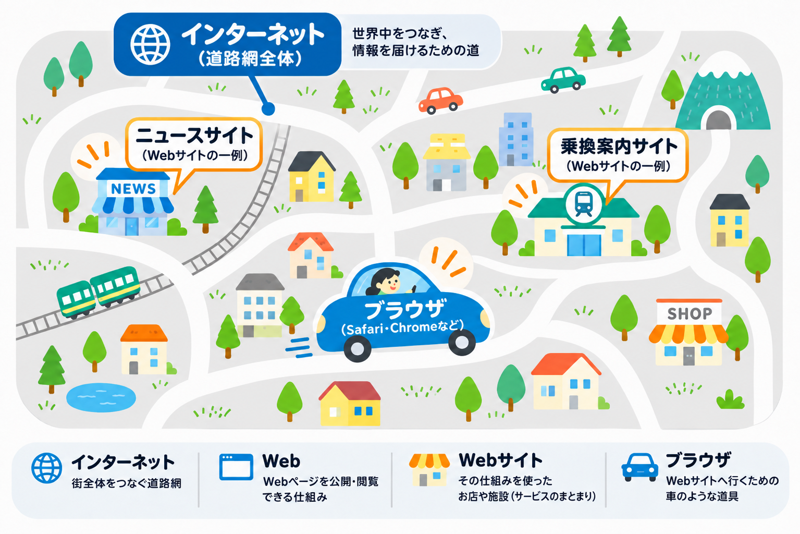

# インターネットとWeb、ブラウザは何が違う？

朝起きてスマホでニュースを読む。出かける前にSafariで乗換案内を調べる。友人にLINEでメッセージを送る。

私たちは毎日、当たり前のように「インターネット」を使っています。

では、ここでひとつ質問です。

**「インターネット」「Web」「ブラウザ」は何が違うのでしょうか？**

普段はあまり意識しませんが、この3つには、それぞれ異なる役割があります。

## インターネットは、世界中をつなぐ道路網

インターネットとは、世界中のコンピューター同士をつなぎ、情報をやり取りできるようにしたネットワークのことです。

これを理解するために、道路を想像してみましょう。

日本全国には道路が張り巡らされており、道路を使ってさまざまな目的地に行くことができます。また、荷物を目的地まで届けることもできます。

インターネットも、これと少し似ています。

世界中のコンピューターは、さまざまな通信設備やネットワークを通じてつながっています。

例えば、東京にいる人が大阪の友人にメッセージを送ると、情報は通信ネットワークを通じて相手に届きます。

**道路が人や荷物を目的地へ運ぶための道であるように、インターネットは情報を目的の相手へ届けるための道だと考えることができます。**

## Webサイトは、道路の先にある目的地

道路を使えば、本屋やレストラン、駅など、さまざまな場所へ行くことができます。

インターネットでも、ニュースサイトや乗換案内サイト、ネットショッピングサイトなど、さまざまな情報やサービスにアクセスできます。

こうしたWebサイトは、道路の先にある「お店や施設」のようなものです。

例えば、乗換案内サイトでは駅名を入力して経路を調べられます。ニュースサイトでは記事を読むことができます。

道路そのものがお店ではないように、インターネットそのものがWebサイトなのではありません。

**インターネットは情報を届けるための道であり、Webサイトはその道を使ってアクセスする目的地のひとつなのです。**

## ブラウザは、Webサイトを利用するための道具

では、SafariやGoogle Chromeは何でしょうか？

これらは「ブラウザ」と呼ばれるアプリです。

ブラウザは、Webサイトの情報を受け取り、私たちが読んだり操作したりできる画面として表示してくれます。

道路のたとえでいえば、目的地に向かうための「車」のような役割です。

Safari自体が乗換案内サイトなのではありません。Safariというブラウザを使って、乗換案内サイトにアクセスしているのです。

## では、Webとは何なのか？

ここまで「インターネット」「Webサイト」「ブラウザ」を紹介してきました。

最後に「Web」について整理しましょう。

Webは、正式には「World Wide Web（ワールド・ワイド・ウェブ）」と呼ばれます。

Webとは、**インターネットなどを利用して、Webページを公開したり、閲覧したり、リンクをたどって別のページへ移動したりできる仕組み**のことです。

つまり、WebとWebサイトは同じではありません。

Webは情報を利用するための仕組み全体であり、Webサイトはその仕組みを使って作られたページのまとまりです。

道路のたとえでいうなら、ニュースサイトや乗換案内サイトは「お店や施設」、Webはそれらの情報やサービスを共通の方法で利用できる仕組みに当たります。

ここで、3つの違いを整理しておきましょう。

- **インターネット：** 世界中のコンピューターをつなぎ、情報を届けるネットワーク
- **Web：** Webページを公開したり、閲覧したりできる仕組み
- **ブラウザ：** Webページを表示・操作するためのアプリ

なお、インターネットを使うときに、必ずブラウザが必要なわけではありません。LINEでのメッセージ送信やオンラインゲームなど、ブラウザを開かずにインターネットを利用することもできます。

では、Safariで乗換案内を使う場合と、専用の乗換案内アプリを使う場合では、何が違うのでしょうか？

次のページで、その違いを見ていきましょう。
