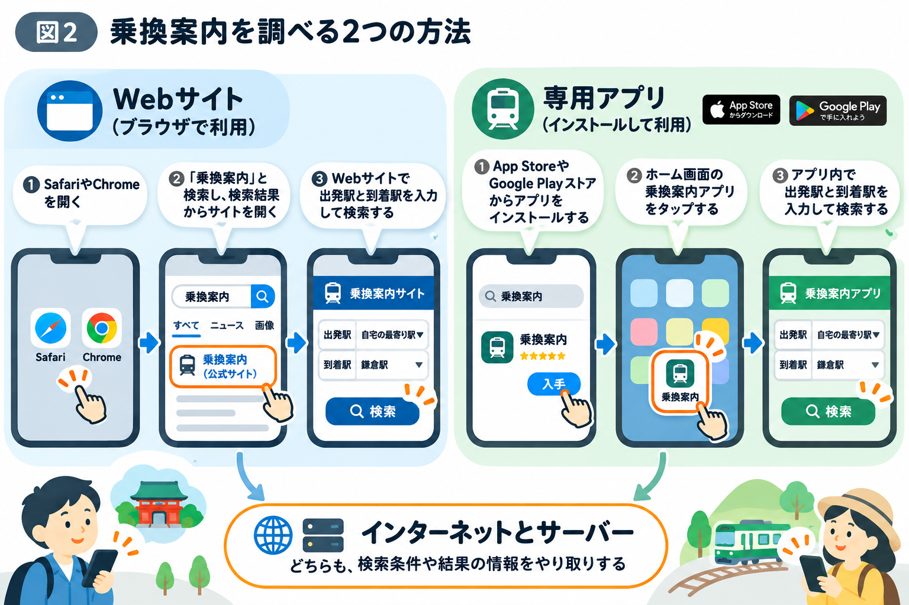

# Webサイトとアプリは何が違う？

## 休日に鎌倉へ出かけるとしたら？

休日に、友達と日帰りで鎌倉へ行くとします。

自分の最寄駅から鎌倉まで、どの電車に乗ればよいのか。多くの人はスマホで乗換案内を調べるでしょう。

このとき、調べ方は大きく2つあります。

1つは、SafariやChromeを開き、「乗換案内」と検索して、表示されたWebサイトで調べる方法。

もう1つは、スマホのホーム画面にある乗換案内アプリを開いて調べる方法です。

どちらも同じように電車の経路を調べられます。

**では、Webサイトと専用アプリは何が違うのでしょうか？**

## Webサイトは、ブラウザから利用する

SafariやChromeなどのブラウザを開き、「乗換案内」と検索します。

検索結果に表示された乗換案内サイトを選び、出発地と目的地を入力すれば、経路を調べられます。

Webサイトのメリットは、専用アプリをインストールしなくても利用できることです。また、Webサイト側の更新は利用者に反映されやすいという特徴があります。

一方、スマホの機能との連携は、ブラウザや利用環境によって制限される場合があります。

## 専用アプリは、インストールして利用する

専用アプリは、App StoreやGoogle Play ストアなどからインストールして利用します。

インストールするとホーム画面などにアプリアイコンが表示され、そこから起動できます。

専用アプリは、通知や位置情報などのスマホの機能と連携しやすいことが特徴です。

一方、インストールの手間や保存容量が必要で、アプリ自体の更新が必要になることもあります。

なお、SafariやChromeもアプリの一種です。ここでは「Webサイト」と「スマホにインストールする専用アプリ」を比較しています。

## Webサイトと専用アプリに共通する仕組み

見た目や使い方が異なっていても、どちらもインターネットを通じてサーバーと通信している場合があります。

例えば、乗換案内で検索した条件をサーバーへ送り、検索結果を受け取る仕組みです。

ここでいうサーバーとは、ほかのコンピューターからの要求に応じて、情報や機能を提供するコンピューターやソフトウェアのことです。

**使い始める入口は違っても、裏側では似た仕組みが動いているのです。**

## Webサイトとアプリ、それぞれの危険

Webサイトでは、本物を装った偽サイトに注意が必要です。

専用アプリでも、偽アプリや不必要な権限を要求するアプリに注意しなければなりません。

どちらも安全に利用するためには、正しいサービスを選ぶことが重要です。

## インターネットの仕組みへ

ここまでで、普段使っているWebサイトやアプリの違いが見えてきました。

では、スマホで検索ボタンを押した瞬間、情報はどこへ送られ、どのように結果が返ってくるのでしょうか？

次の章では、インターネットの通信の仕組みを見ていきます。
