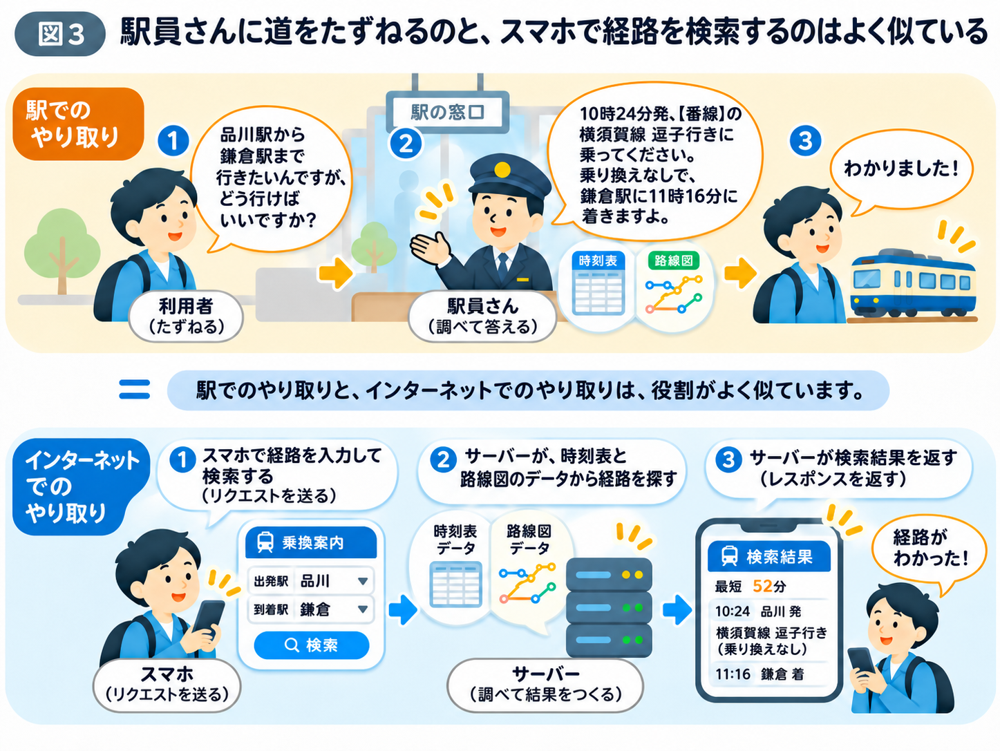

# 検索ボタンを押すと、何が起こる？

前のページでは、Webサイトと専用アプリの違いを学びました。

使い始める方法は違いますが、どちらも検索ボタンを押すと、裏側では似た仕組みが動いています。

では、乗換案内で出発駅と到着駅を入力し、検索ボタンを押したあと、何が起こっているのでしょうか？

この仕組みを、駅員さんに電車の行き方を尋ねる場面にたとえて考えてみましょう。

## ① スマホが検索条件を送る（リクエスト）

休日に友達と鎌倉へ出かけるため、品川駅から鎌倉駅までの行き方を調べるとします。

駅で直接尋ねるなら、駅員さんに「品川駅から鎌倉駅まで行きたいのですが、どう行けばよいですか？」と聞くでしょう。

スマホの乗換案内でも、これと似たことが起こっています。

出発駅に「品川駅」、到着駅に「鎌倉駅」と入力して検索ボタンを押すと、スマホはインターネットを通じて「サーバー」に検索条件を送ります。

**サーバーとは、ほかのコンピューターからの依頼を受け取り、必要な情報や機能を提供するコンピューターやソフトウェアのことです。**

つまり、スマホが乗換案内のサーバーに「品川駅から鎌倉駅までの行き方を教えてください」とお願いしているのです。

このように、スマホなどからサーバーへ送る依頼を「リクエスト」と呼びます。

## ② サーバーが依頼を受け取り、必要な情報を用意する

駅員さんに行き方を尋ねると、駅員さんは時刻表や路線図を確認して、条件に合う電車を探してくれます。

乗換案内のサーバーも、これと似た役割を担っています。

スマホからリクエストを受け取ると、サーバーは路線や時刻表のデータを使って、希望する条件に合った経路を計算します。

例えば、何時の電車に乗ればよいのか、乗り換えが必要なのか、どれくらい時間がかかるのかを確認し、検索結果を用意します。

このように、サーバーは単に保存された情報を渡すだけではありません。必要に応じて情報を探したり、計算したりして、依頼に合った結果を用意するのです。

## ③ サーバーが検索結果を返す（レスポンス）

駅員さんが時刻表を確認すると、「10時24分発の電車に乗れば、乗り換えなしで11時16分に鎌倉駅へ着きますよ」と教えてくれます。

乗換案内のサーバーも、用意した検索結果をインターネット経由でスマホに送り返します。

このように、サーバーがリクエストに対して返す応答を「レスポンス」と呼びます。

スマホは受け取った検索結果を、私たちが読みやすい画面に表示します。

こうして、乗る電車や出発時刻、到着時刻、所要時間などを確認できるのです。

※ここに登場する時刻と経路は、仕組みを説明するための例です。

## スマホとサーバーは役割を分担している

ここまでの流れを整理すると、次のようになります。

1. **スマホが検索条件を送る（リクエスト）**
2. **サーバーが依頼を受け取り、必要な情報を用意する**
3. **サーバーが検索結果を返す（レスポンス）**

スマホは検索条件を送り、返ってきた情報を画面に表示します。一方、サーバーは依頼に応じて必要な処理を行い、その結果を返します。

なお、専用アプリの中には、スマホの中で一部の計算を行うものもあります。必ずしもすべての処理をサーバーに任せるわけではありません。

大切なのは、**インターネットを通じて、スマホとサーバーが役割を分担している**ということです。

ここで、新たな疑問が生まれます。

世界中にはたくさんのサーバーがあります。スマホはその中から、どうやって目的のサーバーを見つけているのでしょうか？

次のページで、その仕組みを見ていきましょう。
