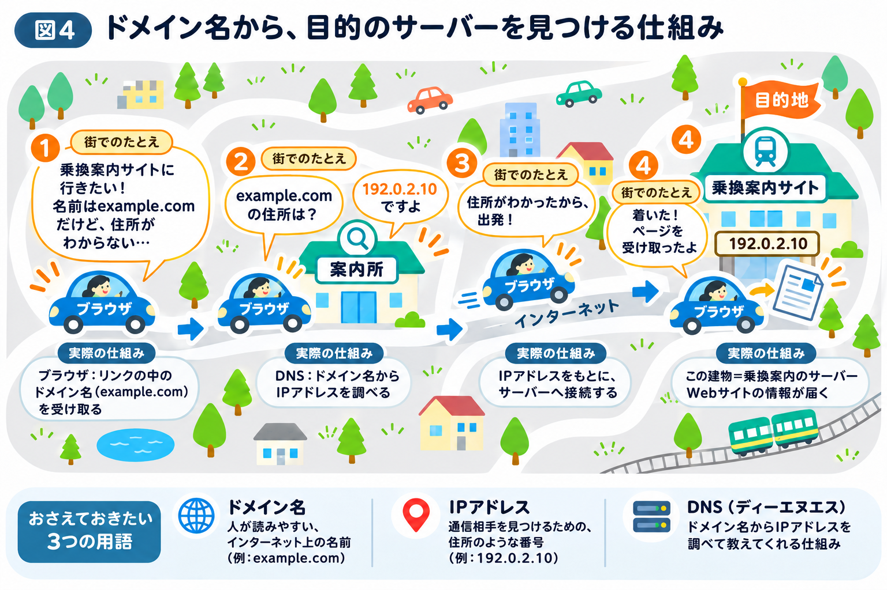

# スマホは、どうやって目的のサーバーを見つける？

前節では、スマホがサーバーに検索条件を送り、検索結果を受け取る仕組みを学びました。

実は、その前にもう1つ大切なことが行われています。

**スマホは、情報を送る前に「どのサーバーに送ればよいのか」を知る必要があるのです。**

例えば、検索結果に出てきた乗換案内のWebサイトをタップしたとき、ブラウザは表示する前に、接続先を見つけるための情報を調べています。

本章の冒頭では、インターネットを街の道路網、Webサイトをお店、ブラウザを車にたとえました。この街で、ブラウザの車が乗換案内サイトを訪ねる場面を想像してみましょう。

## インターネット上にも「住所」のようなものがある

街でお店を訪ねるには、その場所を示す「住所」が必要です。住所がわかれば、初めて行くお店にもたどり着けます。

インターネットでも、目的のサーバーと通信するためには、接続先を識別する情報が必要です。

その役割を果たすのが「IPアドレス」です。

**IPアドレスとは、インターネットなどのネットワーク上で通信相手を識別するために使われる番号のことです。**

例えば、`192.0.2.10` のような数字で表されます。

実際の住所とまったく同じものではありませんが、通信相手を見つけるための手がかりになります。

## 数字の住所は覚えにくい

もしWebサイトを開くたびに、数字のIPアドレスを覚えて入力する必要があったら大変です。

そこで登場するのが「ドメイン名」です。

ドメイン名とは、`example.com` のように、文字を使って表したインターネット上の名前です。数字の並びよりも、人が読んで区別しやすい形になっています。

街のたとえでいえば、ドメイン名はお店の名前のようなものです。数字だけの住所よりも、名前のほうが人にとってはわかりやすいはずです。

ただし、私たちがドメイン名を自分で入力することは、あまりありません。多くの場合は、検索結果やブックマークのリンクをタップしてWebサイトを開きます。

実は、そのリンクの中にドメイン名が含まれています。ブラウザはこのドメイン名を手がかりに、接続先を探しているのです。そのため、私たちは数字のIPアドレスを意識しなくても、Webサイトを利用できます。

## DNSが名前からIPアドレスを調べる

では、Webサイトの名前がわかっただけで、目的のサーバーにたどり着けるのでしょうか？

街の中で考えてみましょう。

「乗換案内のお店に行きたい」と思っても、お店の名前だけでは、どの道路を通って、どこへ向かえばよいのかわかりません。

そんなとき、街の案内所で「乗換案内のお店はどこにありますか？」と聞けば、案内所が地図で調べて住所を教えてくれるでしょう。

インターネットにも、これと似た仕組みがあります。

それが、**DNS（ディーエヌエス）**です。

DNSとは、Webサイトの名前にあたる「ドメイン名」から、住所にあたる「IPアドレス」を調べるための仕組みです。

例えば、ブラウザが `example.com` というドメイン名を手がかりに、DNSへ「この名前のIPアドレスを教えてください」と問い合わせます。

すると、DNSの仕組みを通じて、対応するIPアドレスが返ってきます。

仮に、その番号が `192.0.2.10` だったとしましょう。

ブラウザはその番号を手がかりに、目的のサーバーとの通信を始められます。

ここで重要なのは、**DNSは乗換経路を調べてくれる仕組みではない**ということです。

DNSが教えてくれるのは、あくまで「乗換案内サイトのサーバーへ接続するための情報」です。

そのサーバーにアクセスしたあとで、初めて「品川駅から鎌倉駅までの行き方を教えてください」という検索を行えるのです。

## 目的のサーバーへアクセスする

DNSを使って接続先のIPアドレスがわかると、スマホはその情報を手がかりにサーバーとの通信を始められます。

**図4では、この仕組みを身近な例と比較しています。** 上段は、案内所が地図を使い、お店の名前から住所を見つける流れです。下段は、Webサイトのドメイン名をもとにDNSでIPアドレスを調べ、サーバーに接続して情報を受け取る流れを表しています。つまり、お店の名前が「ドメイン名」、住所が「IPアドレス」、案内所が地図を使って住所を調べる役割が「DNS」にあたります。

ここまでの流れを、図4の①〜④に沿って整理してみましょう。

① 検索結果などのリンクをタップする（リンクにはドメイン名が含まれている）  
② DNSで、ドメイン名に対応するIPアドレスを調べる  
③ IPアドレスをもとに、サーバーに接続する  
④ サーバーにつながり、Webサイトの情報が届く

これはブラウザでWebサイトを見る場合の例ですが、専用アプリでも同じ仕組みを利用することがあります。

例えば、アプリが接続先としてドメイン名を利用している場合は、DNSでIPアドレスを調べてからサーバーと通信できます。

ここで押さえておきたいのは、3つの役割です。

- **ドメイン名：** 人が読みやすい、インターネット上の名前
- **IPアドレス：** 通信相手を見つけるための、住所のような番号
- **DNS：** ドメイン名からIPアドレスを調べて教えてくれる仕組み

なお、実際にはブラウザなどが以前調べた情報を記憶しており、DNSへの問い合わせを省略できることがあります。また、1つのWebサイトが複数のIPアドレスを使ったり、複数のWebサイトが同じIPアドレスを利用したりすることもあります。

つまり、IPアドレスは必ずしも「1台のサーバー専用の住所」というわけではありません。

さて、ここまでで、スマホが目的のサーバーを見つける仕組みがわかりました。

しかし、サーバーが見つかっても、情報はスマホからサーバーへ直接届くわけではありません。実際には、さまざまな通信機器を経由して届けられます。

街のたとえでいえば、住所がわかっても、そこまでどの道を通るのかは、まだ決まっていません。

次節では、**インターネット上でデータがどのように運ばれているのか**を見ていきましょう。
