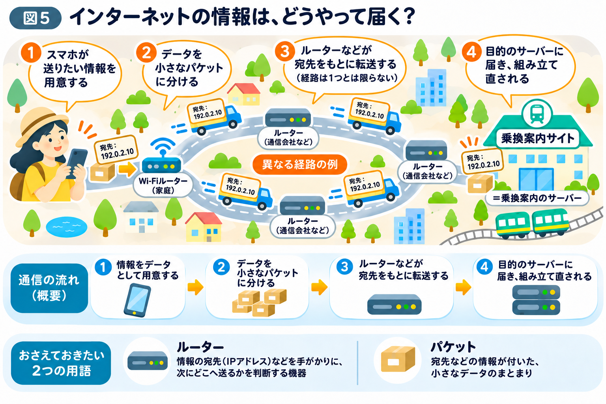
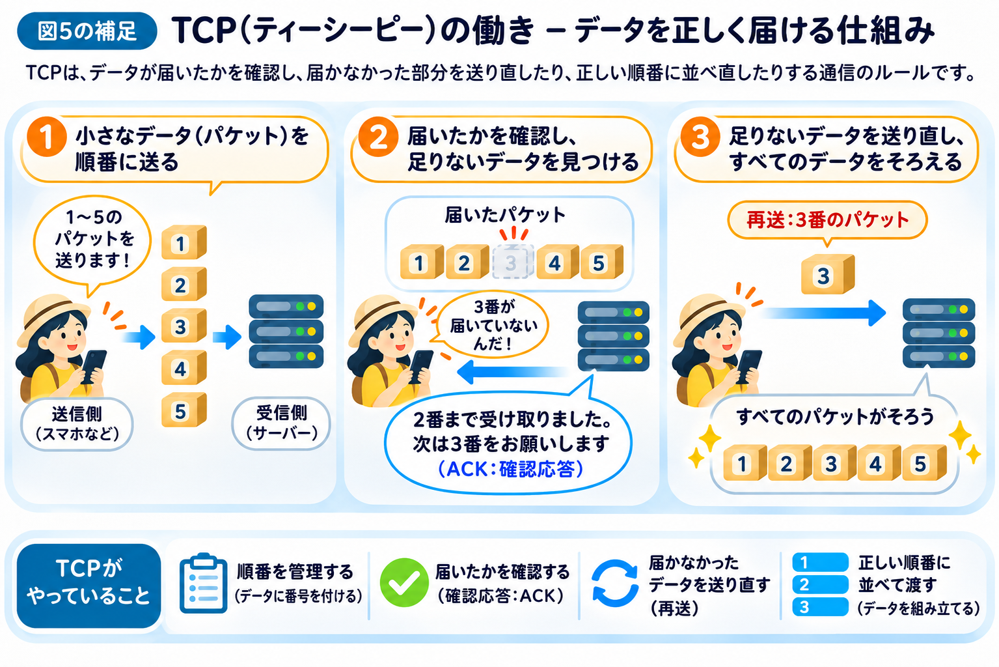

# インターネットの情報は、どうやって届く？

前節では、DNSを使ってドメイン名からIPアドレスを調べ、目的のサーバーを見つける仕組みを学びました。

では、サーバーの住所にあたるIPアドレスがわかったあと、情報はどのように届けられるのでしょうか？

## 情報は、いくつもの道を通って届けられる

本章の冒頭では、ブラウザを、Webサイトというお店に向かう車にたとえました。

ただ、実際に道路を運ばれているのは、ブラウザそのものではありません。スマホとサーバーの間を行き来しているのは、情報を詰めた「荷物」です。

荷物を届けるには、宛先の住所がわかっていても、道路を通って運ばなければなりません。

例えば、家の前の道路から大きな道路へ出て、いくつかの交差点を通り、目的の建物へ向かいます。

インターネットでも、これと似たことが起こっています。

スマホから送られた情報は、Wi-Fiの機器や携帯電話の基地局、通信会社のネットワークなどを経由して、目的のサーバーへ届けられます。

つまり、**スマホとサーバーの間には、情報を運ぶためのさまざまな通信設備がある**のです。

## ルーターは、情報の行き先を判断する

街の道路には交差点があります。

交差点では、目的地へ向かうために、どちらの道へ進むかを選びます。

インターネットにも、これと似た役割を持つ機器があります。

それが「ルーター」です。

**ルーターとは、情報の宛先であるIPアドレスなどを手がかりに、次にどこへ情報を送るかを判断する機器です。**

例えば、スマホから乗換案内のサーバーへ情報を送るとき、途中のルーターは宛先を確認し、次に情報を渡す相手を選びます。

そして、次のルーターも同じように送り先を判断します。

このようなやり取りを繰り返すことで、情報は目的のサーバーへ届けられます。

なお、自宅にあるWi-Fiルーターもルーターの一種ですが、インターネット上には通信会社などが管理する多くのルーターが存在しています。

## 大きな情報は、小さく分けて運ばれる

ここでもう1つ、重要な仕組みがあります。

私たちがスマホでやり取りする写真やメッセージなどの「情報」は、コンピューターの中では「データ」として扱われています。

インターネットでは、このデータを「パケット」という小さなまとまりに分けて送ります。

例えば、友達に旅行先で撮影した写真を送るとします。

このとき、**届けたい写真が「情報」であり、写真のデータを通信で運べるように小分けにしたものが「パケット」**です。

引っ越しの荷物を、いくつもの段ボールに分けて運ぶようなイメージです。

1つの写真を送るために、たくさんのパケットが使われることもあります。一方、乗換案内の検索条件のような小さなデータなら、少ないパケットで送れます。

パケットには、宛先などの、届けるための目印も付けられています。

ルーターは、パケットに付いた宛先を手がかりに転送します。

そして、受け取る側では、届いたパケットのデータを正しい順番に組み合わせるなどして、元の写真やメッセージを再現します。

つまり、**情報をデータとして扱い、そのデータを小さなパケットに分けて運ぶことで、インターネット上の通信が成り立っている**のです。

## パケットは、必ずしも同じ道を通るわけではない

街で目的地に行くとき、行き方が1つとは限りません。

大通りを使うこともあれば、別の道を通ることもあります。

インターネットでも同じように、通信の状況やネットワークの設定によって、データの通り道が変わることがあります。

そのため、同じ情報を構成するパケットでも、必ずしもすべてが同じ経路を通るとは限りません。

また、通信の途中でパケットが失われたり、届く順番が前後したりする場合もあります。

では、もしパケットが届かなかったら、どうなるのでしょうか？

## TCPは、データが正しく届くように助けてくれる

例えば、引っ越しの荷物を5個の段ボールに分けて送ったとします。

ところが、荷物が届いて確認すると、3番の段ボールだけがありませんでした。

これでは、すべての荷物が揃いません。

インターネットでも、同じようにデータの一部が届かないことがあります。

そこで役立つのが、**TCP（ティーシーピー）**という通信のルールです（図5の補足）。

TCPは、英語の *Transmission Control Protocol* の略です。

**TCPとは、データが相手に届いたかどうかを確認し、届かなかった部分を必要に応じて送り直したり、正しい順番で受け取れるようにしたりする仕組み**です。

先ほどの段ボールの例で考えてみましょう。

配送した荷物に番号が付いていれば、受け取った側はどの荷物が届いたのかを確認できます。

そして、3番の荷物が届いていなければ、送り直してもらうことで、すべての荷物を揃えられます。

TCPでも、これと似たことを行っています。

TCPは送信するデータの位置がわかるように番号を管理し、受け取った側は、どこまでデータを受け取ったかを送信側に知らせます。

この「受け取りました」という知らせを、**確認応答（ACK：アック）**と呼びます。

必要なデータが届いていないと判断した場合は、その部分を送り直します。届く順番が前後しても、元の順番に整えてからアプリに渡せるようにします。

つまり、**ルーターはパケットを次の場所へ送り、TCPはデータが正しく受け渡されるように管理する**という役割の違いがあります。

ただし、TCPを使っても通信が必ず成功するわけではありません。また、すべてのインターネット通信でTCPが使われるわけでもありません。

## インターネットは、情報を届ける仕組み

ここまでの流れを、図5の①〜④に沿って整理してみましょう。

① スマホが送りたい情報を、データとして用意する  
② データを小さなパケットに分ける  
③ ルーターなどが、宛先をもとに転送する  
④ 目的のサーバーに届き、データが組み立て直される

サーバーが検索結果を返すときも、同じ仕組みで、今度はサーバーからスマホへ情報が届けられます。

この一連の通信では、TCPなどの仕組みが必要に応じて、データの受信確認や再送、順番の管理を行っています。

このように、インターネットは多くの通信機器やネットワークが協力することで成り立っています。

普段、私たちは検索ボタンを押すだけですが、その裏側では情報がいくつもの機器を経由して届けられています。

では、サーバーから返ってきた情報は、どうやって私たちが見ているWebサイトの画面になるのでしょうか？

次節では、**Webサイトの画面が作られる仕組み**を見ていきましょう。
