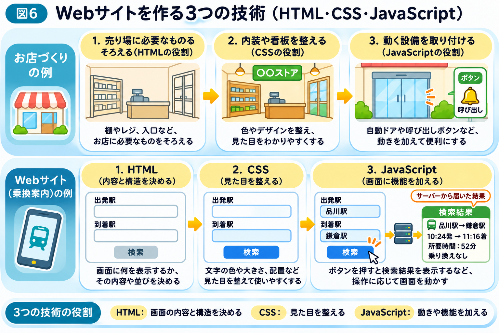

# Webサイトの画面は、どうやって作られる？

前のページでは、インターネットを通じて、スマホとサーバーの間でデータが運ばれる仕組みを学びました。

では、サーバーから届いたデータは、どうやって私たちが普段見ているWebサイトの画面になるのでしょうか？

例えば、SafariやChromeで乗換案内サイトを開くと、駅名を入力する欄や検索ボタン、路線の情報などが表示されます。

実は、こうした画面も、いくつかの技術を組み合わせて作られています。

## Webサイトの画面は、3つの技術で作られる

最初のページでは、Webサイトを街の「お店」にたとえました。ここでは、そのお店がどのように作られているのかを見てみましょう。

お店を作るときは、まず棚やレジ、入口など、お店に必要なものをそろえます。次に、内装や看板のデザインを整えます。さらに、自動ドアや呼び出しボタンのような設備を取り付けます。

Webサイトの画面も、これに少し似ています。

Webサイトの画面を作るために、主に次の3つの技術が使われます。

- **HTML（エイチティーエムエル）：** 画面に何を表示するか、その内容や構造を決める
- **CSS（シーエスエス）：** 文字の色や大きさ、配置など、見た目を整える
- **JavaScript（ジャバスクリプト）：** ボタンを押したときの動きなど、画面に機能を加える

お店にたとえるなら、HTMLが棚やレジ、入口など、お店に必要なもの、CSSが内装や看板のデザイン、JavaScriptが自動ドアや呼び出しボタンのような役割です（図6）。

## HTMLは、画面の内容と構造を決める

乗換案内サイトには、「出発駅」「到着駅」という文字や、入力欄、検索ボタンがあります。

HTMLは、こうした部品を画面に置くことと、その並び順を表します。

例えば、「ここは見出し」「ここは駅名の入力欄」「ここはボタン」といった役割を指定します。

ブラウザはHTMLを読み取り、画面の基本的な構造を組み立てます。

## CSSは、画面の見た目を整える

HTMLだけでも、文字や入力欄などを表示できます。

しかし、文字の大きさや色、余白、配置を工夫しなければ、使いやすい画面にはなりません。

そこで使われるのがCSSです。

例えば、検索ボタンを青色にしたり、駅名の入力欄を見やすく並べたり、スマホの画面幅に合わせて配置を変えたりできます。

つまり、HTMLが画面の内容や構造を決め、CSSが見た目を整えるのです。

## JavaScriptは、画面に動きを加える

では、検索ボタンを押したときに画面が切り替わったり、入力内容に応じて候補駅が表示されたりするのは、どうしてでしょうか？

こうした動作の実現に使われる代表的な技術がJavaScriptです。

例えば、駅名を入力すると候補を表示したり、検索ボタンが押されたことを検知したりできます。

また、サーバーにリクエストを送り、返ってきたレスポンスを画面に反映することもできます。

ただし、Webサイトのすべての動きにJavaScriptが必要なわけではありません。HTMLだけで実現できる操作もあります。

## ブラウザが、Webサイトを画面に表示する

ここまでの仕組みを整理してみましょう。

乗換案内サイトを開くと、ブラウザはサーバーなどからWebサイトを表示するためのデータを受け取ります。

そして、HTMLで画面の構造を理解し、CSSを使って見た目を整え、必要に応じてJavaScriptを実行します。

こうして、私たちが普段目にしているWebサイトが表示されるのです。

なお、乗換経路の計算そのものは、多くの場合、「検索ボタンを押すと、何が起こる？」のページで紹介したように、サーバーが担当しています。

**私たちが見ているWebサイトの画面は、ブラウザとサーバーが役割を分担することで成り立っています。**

ところで、前のページで見たように、スマホとサーバーの間の情報は、たくさんの通信機器を経由して届けられます。

では、その途中で、情報を誰かに見られてしまうことはないのでしょうか？

次のページでは、通信を守る「HTTPS」という仕組みを見ていきましょう。
