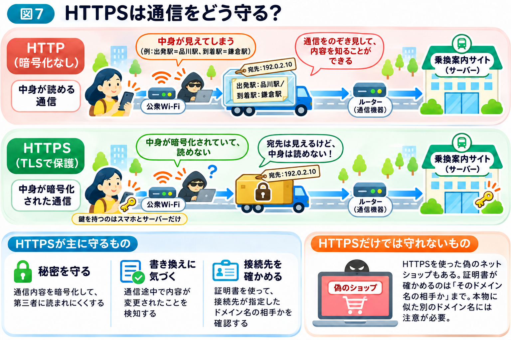

# HTTPSは、どうやって通信を守っている？

前節では、HTML・CSS・JavaScriptを使ってWebサイトの画面が作られる仕組みを学びました。

そして、ページの最後で、1つの疑問が出てきました。

スマホとサーバーの間でやり取りしている情報を、途中で誰かに見られてしまうことはないのでしょうか？

## インターネットの通信は、たくさんの機器を通って届く

本章の冒頭で、インターネットを街の道路網にたとえました。

そして、「インターネットの情報は、どうやって届く？」のページでは、情報がパケットという小さな荷物になり、いくつもの通信機器を経由して運ばれることを学びました。

例えば、乗換案内サイトで出発駅や到着駅を入力すると、その情報がインターネットを通じてサーバーへ送られます。

もし、この荷物の中身を誰でも読める状態で送っていたら、途中で通信をのぞき見できる人に、内容を知られてしまう可能性があります。例えば、カフェや駅などの公衆Wi-Fiは、同じネットワークを多くの人が使うため、通信をのぞき見されるおそれがある場所の1つです。

乗換案内の検索条件なら、大きな問題にならない場合もあるでしょう。

しかし、ネットショッピングで入力した住所や、ログインするときのパスワードだったらどうでしょうか？

こうした情報が他人に知られてしまうと、悪用されるおそれがあります。

## HTTPSは、通信の内容を暗号化する

そこで重要になるのが、**HTTPS（エイチティーティーピーエス）**という仕組みです。

まず、HTTP（エイチティーティーピー）とは、ブラウザとWebサーバーが情報をやり取りする際に使う通信のルールです。

「検索ボタンを押すと、何が起こる？」のページで紹介した「リクエスト」と「レスポンス」のやり取りは、実はこのHTTPというルールに沿って行われています。

HTTPSは、このHTTPのやり取りを、TLS（ティーエルエス）という技術を使って保護する仕組みです。

TLSは、正式には「Transport Layer Security（トランスポート・レイヤー・セキュリティ）」といいます。通信相手を確かめ、情報を暗号化し、途中で書き換えられていないかを確認するための技術です。

つまり、**HTTPが「情報をやり取りするためのルール」だとすると、TLSは「そのやり取りを安全にするための仕組み」であり、両者を組み合わせたものがHTTPS**です。

その大きな特徴の1つが「暗号化」です。

暗号化とは、**情報を、決められた方法と鍵を使わなければ元の内容を読み取れない形に変えること**です。

例えば、トラックで運ばれる段ボールが透明だったら、途中で誰かに中身を見られてしまいます。

一方、鍵のかかった頑丈な箱に入れて運べば、箱そのものを見られても、中身は簡単には読まれません。箱を開ける鍵を持っているのは、スマホとサーバーだけです。

HTTPSは、この「鍵のかかった箱」に似ています（図7）。

スマホとWebサーバーの間でやり取りする情報を暗号化することで、通信経路の途中から内容を読み取られにくくしています。

## TLSは、通信を始めるときに何をしている？

では、TLSは具体的にどのように通信を守っているのでしょうか？

例えば、SafariやChromeで乗換案内サイトを開く場面を考えてみましょう。

TLSを使った通信では、暗号化を始めるための準備として、大まかに次のことが行われます。これらは互いに関係しながら進むため、必ずしも以下の順に一つずつ完了するわけではありません。

**・通信に必要な情報と鍵を準備する**

ブラウザとサーバーは、利用する暗号化方式などを決め、通信内容を暗号化するための鍵を安全に作れるよう、必要な情報を交換します。

**・通信相手を確認する**

ブラウザは、サーバーから提示された証明書などを確認し、接続先が指定したドメイン名に対応しているか確かめます。また、ここまでの情報交換が途中で書き換えられていないことも確認します。

**・暗号化して情報をやり取りする**

鍵の準備ができると、検索条件や検索結果などを暗号化して送ります。また、途中で内容が書き換えられていないかも確認します。

このように、TLSは通信を始めるための準備を行い、その後の情報のやり取りを保護しています。

## HTTPSは、情報の書き換えも検知する

HTTPSが守っているのは、情報を読まれないことだけではありません。

例えば、乗換案内の検索結果が途中で勝手に書き換えられたら困ります。

HTTPSで利用されるTLSには、通信内容が途中で不正に変更されていないかを確かめる仕組みもあります。

## HTTPSは、接続先が本物かも確かめる

もう1つ大切なのが、接続先の確認です。

「ドメイン名から、目的のサーバーを見つける仕組み」では、DNSを使ってドメイン名からIPアドレスを調べることを学びました。

しかし、もし途中で偽のサーバーに誘導されてしまったら、鍵のかかった箱を偽物の相手に渡してしまうことになります。

そこでHTTPSでは、「証明書」を使って、接続先のサーバーが指定したドメイン名を利用する正当な権限を持っているかを確かめます。

証明書は、信頼できる認証局が発行する「身分証明書」のようなものです。ブラウザは、その証明書が信頼できるか、接続先のドメイン名と一致するか、有効期限内かなどを確認します。確認できない場合は、警告を表示します。

ただし、証明書が確認するのは、指定したドメイン名に対して正当な証明書が使われているかどうかです。Webサイトを運営する会社が信用できるか、販売している商品が本物かまでは保証しません。

もし、本物によく似た別のドメイン名を使った偽サイトだった場合、その偽サイトのドメイン名に対する証明書が正しく発行されていることもあります。

まとめると、HTTPSは主に次の3つを実現します。

- **秘密を守る：** 通信内容を暗号化して、第三者に読まれにくくする
- **書き換えに気づく：** 通信途中で内容が変更されたことを検知する
- **接続先を確かめる：** 証明書を使って、接続先が指定したドメイン名の相手かを確認する

## HTTPSなら、どんなWebサイトでも安全？

ここで注意したいことがあります。

**HTTPSで通信しているからといって、そのWebサイト自体が安全とは限りません。**

例えば、詐欺を目的とした偽のネットショップでも、HTTPSを使うことはできます。

HTTPSが主に守るのは、スマホと接続先のサーバーとの通信です。

その接続先が信用できる会社なのか、入力した情報を適切に扱ってくれるのか、販売している商品が本物なのかまでは保証しません。

本物そっくりの偽サイトに自分からパスワードを入力してしまえば、HTTPSが使われていても、その情報は偽サイトの運営者に渡ってしまいます。

また、暗号化されていても、接続先のドメイン名など一部の通信情報が第三者にわかる場合があります。箱に鍵をかけても、荷札の宛先は見えるのと同じです。

ブラウザでは、通信が保護されているかをアドレス欄やサイト情報の画面から確認できます。ただし、スマートフォンでは `https://` や鍵の印が常に表示されるとは限りません。表示だけに頼らず、ブラウザの警告を無視しないこと、接続先のドメイン名全体を確認することが大切です。

**通信が安全であることと、利用するWebサイトが安全であることは、別の問題なのです。**

## 通信が守られていても、危険は残っている

HTTPSによって、通信の途中で読まれたり、書き換えられたり、偽のサーバーにつながったりする危険は小さくできます。

しかし、それだけでインターネットを利用するうえでの危険がすべてなくなるわけではありません。

次節では、インターネットのどこに危険が潜んでいるのかを見ていきましょう。
