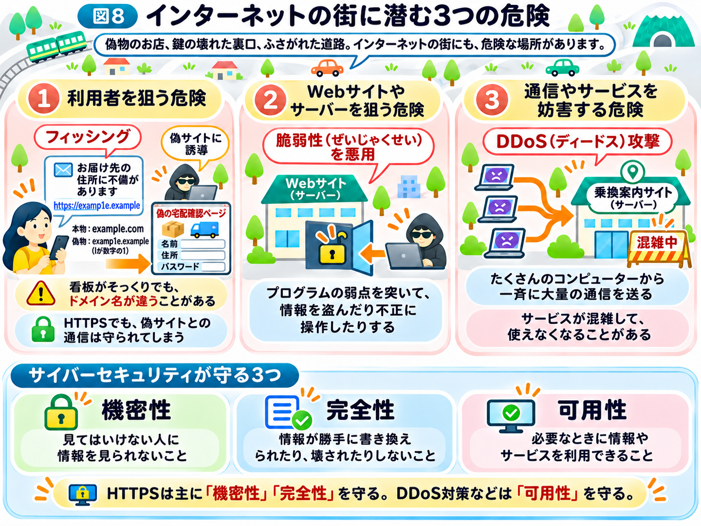

# インターネットには、どんな危険が潜んでいる？

ここまで、スマホで乗換案内を調べる場面を例に、インターネットの仕組みを学んできました。

Webサイトを開くときにはDNSを使って接続先を調べ、インターネットを通じてサーバーと情報をやり取りします。サーバーから届いたデータは、ブラウザによって私たちが見やすい画面に表示されます。

また、HTTPSを使えば、通信の途中で情報を盗み見られたり、書き換えられたり、偽のサーバーにつながったりする危険を小さくできます。

では、HTTPSで通信を守っていれば、安心してインターネットを使えるのでしょうか？

実は、インターネットには、通信を守るだけでは防げない危険も存在しています。

## インターネットの街には、危険な場所もある

最初のページでは、インターネットを道路網、Webサイトをお店、ブラウザを車にたとえました。

街の中には、安心して利用できるお店がある一方で、人をだましてお金や情報を盗もうとする偽物のお店があるかもしれません。

また、お店の建物に鍵のかかっていない裏口があれば、悪意のある人が侵入するかもしれません。

さらに、わざと大勢で道路をふさがれたら、お店にたどり着くことさえできなくなります。

インターネットの世界も、これと似ています。

どこが狙われるのか、3つに分けて見ていきましょう。

## ① 利用者を狙う危険

例えば、スマホに次のようなメッセージが届いたとします。

「お届け先の住所に不備があります。こちらから確認してください」

宅配業者からの連絡に見えますが、実は偽のWebサイトへ誘導するメッセージかもしれません。

リンクを開くと、本物そっくりの画面が表示され、名前や住所、パスワードなどの入力を求められます。

これは「フィッシング」と呼ばれる手口の一例です。

前のページで学んだように、HTTPSの証明書が確かめるのは「そのドメイン名の相手と通信している」ことまでです。偽サイトが本物によく似た別のドメイン名を使っていれば、HTTPSは偽サイトとの通信をしっかり守ってしまいます。

そのため、リンクを開く前に、ドメイン名が本物と同じかを確かめることが大切です。

街のたとえでいえば、看板がそっくりでも、住所がまったく違う偽物のお店のようなものです。

**通信が暗号化されていることと、利用者がだまされないことは別の問題なのです。**

## ② Webサイトやサーバーを狙う危険

Webサイトやサーバーも、人が作ったプログラムによって動いています。

そのプログラムに、設計や実装のミスが見つかることがあります。

こうした、セキュリティ上の弱点を「脆弱性（ぜいじゃくせい）」と呼びます。

街のお店にたとえるなら、誰でも入れてしまう裏口や、壊れた鍵のようなものです。

悪意のある人が脆弱性を悪用すると、本来は見られない情報を盗んだり、サーバーを不正に操作したりすることがあります。

なお、すべての脆弱性がすぐに悪用できるわけではありません。しかし、放置すると大きな被害につながる場合があります。

## ③ 通信やサービスを妨害する危険

インターネットでは、データが多くの通信機器を経由して届けられることを学びました。

では、あるWebサイトに大量のアクセスが集中したらどうなるでしょうか？

混雑した道路で車がなかなか進めなくなるように、サーバーやネットワークが処理しきれなくなり、サービスが利用しにくくなることがあります。

悪意を持って大量の通信を送り、サービスを妨害する攻撃も存在します。

特に、たくさんのコンピューターから一斉に大量の通信を送る攻撃を「DDoS（ディードス）攻撃」と呼びます。1か所からの攻撃なら止めやすくても、あちこちから一斉に押し寄せると防ぐのが難しくなります。

例えば、乗換案内サイトが攻撃を受けて利用できなくなると、私たちは必要な電車の情報を確認できなくなるかもしれません。

つまり、サイバー攻撃は情報を盗むだけでなく、**普段使っているサービスを止めてしまう危険**もあるのです。

## サイバーセキュリティは、何を守るためにあるのか？

ここまで紹介した危険は、大きく3つの被害に分けられます。

情報を盗まれること、情報を勝手に書き換えられること、必要なサービスが使えなくなることです。

サイバーセキュリティでは、こうした被害を防ぐために、主に次の3つの観点が大切にされています。

- **機密性：** 見てはいけない人に情報を見られないこと
- **完全性：** 情報が勝手に書き換えられたり、壊されたりしないこと
- **可用性：** 必要なときに情報やサービスを利用できること

例えば、乗換案内サービスなら、利用者の個人情報を守ることが機密性、正しい経路を表示することが完全性、必要なときに検索できることが可用性に関係します。

前のページで学んだHTTPSの「秘密を守る」は機密性、「書き換えに気づく」は完全性を守る仕組みです。一方、DDoS攻撃のようにサービスを止める攻撃から可用性を守るには、HTTPSとは別の対策が必要になります。

## 第2章へ｜ハッキングは、どのように行われるのか？

インターネットは、世界中の人やコンピューターをつなぎ、便利なサービスを利用できるようにしてくれます。

一方で、その仕組みを悪用して、情報を盗んだり、プログラムの弱点を突いたり、サービスを妨害したりする人もいます。

では、攻撃者はどのように弱点を見つけ、悪用しているのでしょうか？

次の章では、**「ハッキングの仕組み」**を、具体的な事例とともに見ていきましょう。
