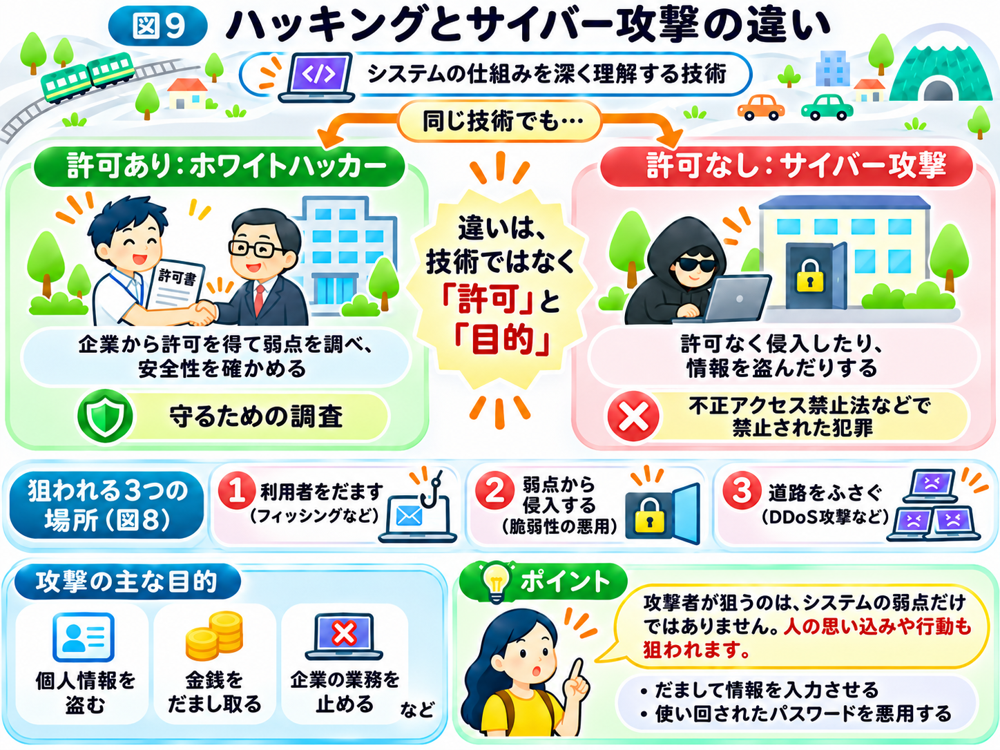

# ハッキングとは何か？

前の章では、インターネットの仕組みと、そこに潜む危険について学びました。

Webサイトやサーバーは、便利なサービスを提供してくれる一方で、悪意のある人から狙われることがあります。

ニュースでは「企業がハッキングされた」「大量の個人情報が流出した」といった話を耳にすることもあります。

では、そもそも「ハッキング」とは何なのでしょうか？

## ハッキングは、もともと悪い意味だけではない

「ハッキング」と聞くと、黒い服を着た人物がパソコンに向かい、他人のシステムへ侵入する場面を想像するかもしれません。この本の図でも、わかりやすさのために攻撃者をそのような姿で描いてきました。

しかし、ハッキングという言葉は、もともとコンピューターやプログラムの仕組みを深く理解し、工夫して扱うことにも使われてきました。

そのため、ハッキングが必ずしも犯罪を意味するわけではありません。

例えば、企業から許可を得てシステムの弱点を調べ、安全性を確認する専門家もいます。こうした人は「ホワイトハッカー」と呼ばれることもあります。

一方、許可なく他人のシステムへ侵入したり、情報を盗んだりする行為は、日本では「不正アクセス禁止法」などの法律で禁止されている犯罪です。

この本では、許可なくシステムや人を狙って被害を与える行為を「サイバー攻撃」と呼びます。

大切なのは、技術を持っていることではなく、その技術を何の目的で、どのように使うかということです。

## 攻撃者は、インターネットのどこを狙う？

前の章の図8では、インターネットの街に潜む3つの危険を見ました。

① 本物そっくりの偽物のお店で、利用者をだます（フィッシングなど）  
② お店の壊れた鍵や裏口から侵入する（脆弱性の悪用）  
③ 大勢で道路をふさいで、お店にたどり着けなくする（DDoS攻撃など）

攻撃者は、この3つのどこかを狙ってきます。

## 攻撃者は、何を目的にしているのか？

システムへの侵入は、攻撃者にとって手段の1つにすぎません。

例えば、個人情報やパスワードを盗む、金銭をだまし取る、企業の業務を止めるなど、さまざまな目的があります。

また、攻撃者が使うのは、高度なプログラミング技術だけではありません。

利用者をだまして情報を入力させたり、使い回されたパスワードを悪用したりすることもあります。

つまり、**サイバー攻撃は、コンピューターの弱点だけでなく、人の思い込みや行動も狙っている**のです。

## 攻撃の仕組みを知ることが、セキュリティ対策につながる

ここまで見てきたように、インターネットの便利な仕組みは、悪意のある人に利用されることもあります。

だからこそ、攻撃がどのように行われるのかを知ることが大切です。攻撃者が何を狙い、どのような仕組みを悪用するのかがわかれば、必要なセキュリティ対策も理解しやすくなります。

この章では、攻撃の前に行われる「下調べ」から始めて、利用者をだます攻撃、Webサイトやサーバーの弱点を狙う攻撃、サービスを妨害する攻撃について、具体例を使って解説します。

まず次のページでは、攻撃者が狙う相手や弱点をどのように見つけているのかを見ていきましょう。

