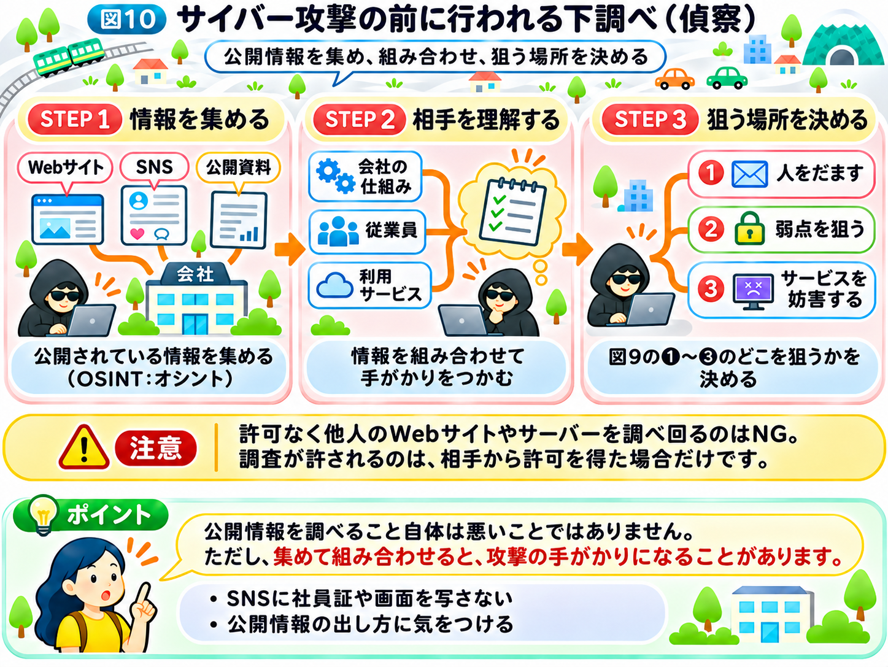

# 攻撃者は、どうやって狙う相手を見つける？

前節では、攻撃者が情報を盗んだり、お金をだまし取ったり、企業の業務を止めたりするために、さまざまな方法を使うことを学びました。

では、攻撃者は最初から、どのシステムに弱点があるのか、誰を狙えばよいのかを知っているのでしょうか？

多くの場合、そうではありません。

特定の企業や人を狙う攻撃では、攻撃を始める前に、相手について情報を集めます。

前節で予告したこの「下調べ」は、「偵察（ていさつ）」や「情報収集」とも呼ばれます。

## 攻撃者は、まず相手について調べる

「インターネットの仕組み」で紹介した「インターネットの街」を思い出してみましょう。

街には、たくさんのお店や会社の建物があります。

もし悪意のある人が、あるお店に侵入しようと考えたら、最初に何をするでしょうか？

例えば、お店がどこにあるのか、入口がいくつあるのか、いつ営業しているのかなどを、外から調べるかもしれません。

インターネットでも、これと似たことが行われます。

攻撃者は、企業のWebサイトや公開されている情報を調べ、どのようなサービスを提供しているのか、どのようなシステムを使っているのかなどを把握しようとします。

**攻撃者は、いきなり侵入するのではなく、まず相手を知ることから始めるのです。**

## インターネットには、誰でも見られる情報がある

例えば、ある会社の公式Webサイトを見てみましょう。

会社の所在地や電話番号、問い合わせ窓口、従業員の紹介など、さまざまな情報が掲載されていることがあります。

また、SNSでは、従業員が仕事の様子を投稿していることもあります。

こうした、誰でも見ることができる情報は、企業について知るための手がかりになります。

なお、これらの情報が公開されていること自体が悪いわけではありません。

しかし、攻撃者が複数の情報を組み合わせると、企業の内部事情や、狙いやすそうな相手を推測する材料になる場合があります。

例えば、従業員の名前や部署を知った攻撃者が、その人の取引先を装った偽のメールを送ることも考えられます。

このように、**一つひとつは普通の情報でも、集めて組み合わせることで攻撃に悪用される場合がある**のです。

## 公開情報を調べる「OSINT」とは？

ここで「OSINT（オシント）」という言葉を紹介します。

OSINTは、英語の *Open Source Intelligence* の略で、一般に公開されている情報を収集・分析することを指します。

例えば、企業の公式Webサイトや公開資料、ニュース記事、SNSなどから情報を調べることです。

OSINTそのものは、悪い行為ではありません。

報道機関が事実を調べたり、企業が市場を分析したり、セキュリティの専門家が公開情報によるリスクを確認したりする場合にも使われます。

ただし、攻撃者がOSINTを悪用することもあります。

例えば、SNSの投稿に写り込んだ社員証やパソコンの画面から、社内のシステム名やメールアドレスの形式を読み取ろうとすることがあります。

大切なのは、**情報を調べる技術そのものではなく、集めた情報を何のために使うか**ということです。

これは、前節で学んだハッキングとサイバー攻撃の違いにもつながります。

## システムの弱点を探すこともある

攻撃者が調べるのは、人や会社の情報だけではありません。

インターネットにつながっているシステムについても、情報を集めることがあります。

例えば、お店の外から、どこに入口があるのかを確認するように、外部から利用できるサービスや、公開されているシステムの情報を調べることがあります。

その中に、古いソフトウェアや設定のミスなどがあれば、攻撃の手がかりになるかもしれません。

「インターネットの仕組み」では、こうしたセキュリティ上の弱点を「脆弱性（ぜいじゃくせい）」と呼ぶことを学びました。

ただし、古いソフトウェアを使っているからといって、必ず侵入できるわけではありません。また、公開情報を調べただけで、弱点が見つかるとも限りません。

攻撃者は、調べて得られた情報をもとに、次にどこを狙うかを考える場合があるのです。

ここで1つ、大切な注意があります。許可なく他人のシステムを調べ回る行為は、相手に迷惑をかけたり、法律上の問題になったりするおそれがあります。前節で学んだように、こうした調査が許されるのは、相手から許可を得た場合だけです。興味があっても、他人のWebサイトやサーバーで試すことはやめましょう。

## 下調べの流れを整理しよう

ここまでの流れを整理してみましょう。

**ステップ1　情報を集める：** WebサイトやSNSなどから公開情報を調べる

**ステップ2　相手を理解する：** 企業の仕組みや従業員、利用しているサービスについて手がかりを得る

**ステップ3　狙う場所を決める：** 図9の①〜③のうち、人をだますのか、システムの弱点を狙うのかなどを決める

ただし、すべてのサイバー攻撃で、この順番の下調べが行われるわけではありません。

無差別に多くの人へ偽メールを送るなど、特定の相手を詳しく調べずに行われる攻撃もあります。

それでも、攻撃前の情報収集を知ることで、普段公開している情報が、思いがけない形で悪用される可能性を理解できます。

SNSに仕事の様子を投稿するときは、社員証や画面、書類などが写り込んでいないかを確かめるだけでも、攻撃者に渡る手がかりを減らせます。

では、攻撃者が利用者の名前やメールアドレスを知ったあと、どのようにしてパスワードを盗もうとするのでしょうか？

次節では、**「パスワードは、どうやって盗まれる？」**を見ていきましょう。

