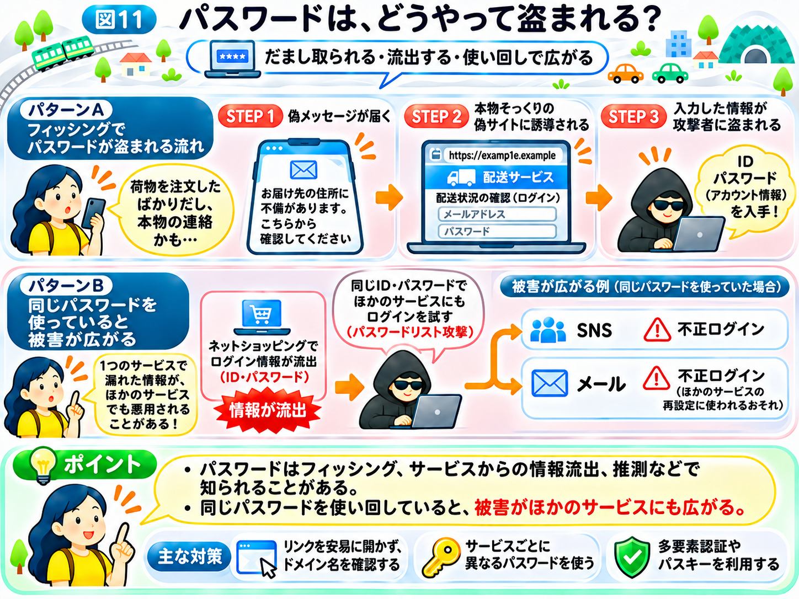

# パスワードは、どうやって盗まれる？

前のページでは、攻撃者がWebサイトやSNSなどから情報を集め、狙う相手について下調べすることを学びました。

では、攻撃者は、どのような方法で攻撃を仕掛けるのでしょうか？

今回は、私たちが普段使っている「パスワード」に注目してみましょう。

パスワードは、メールやSNS、ネットショッピングなど、自分のアカウントにログインするために使われます。

もし他人にパスワードを知られてしまったら、本人になりすましてログインされるおそれがあります。

## 本物そっくりの偽サイトで、パスワードを盗む

第1章でも紹介した、次のようなメッセージを思い出してください。

「お届け先の住所に不備があります。こちらから確認してください」

ちょうどネットショッピングで荷物を注文したばかりだったら、本物の配送業者からの連絡だと思ってしまうかもしれません。

メッセージのリンクを開くと、配送業者のWebサイトによく似た画面が表示されます。

そこには「配送状況を確認するにはログインしてください」と書かれ、メールアドレスとパスワードの入力欄があります。

利用者が入力すると、その情報が偽サイトの運営者に渡ってしまいます。

このように、**本物の企業やサービスを装い、利用者をだましてパスワードなどの情報を入力させる手口が「フィッシング」です。**

この手口が厄介なのは、「荷物を注文したばかり」という、利用者の状況や思い込みを突いてくることです。「ハッキングとは何か？」のページで学んだように、攻撃者は人の思い込みや行動も狙っています。

宅配のメッセージは、多くの人に無差別に送られることがほとんどです。一方、下調べで集めた名前や取引先の情報を使えば、「いつもの取引先から届いた請求書」のように、特定の相手に合わせた、さらに本物らしいメールを作ることもできます。

第1章の「インターネットの街」にたとえるなら、本物のお店とそっくりの看板を掲げた偽物のお店に入り、大切な鍵を渡してしまうようなものです。

ここで注意したいのは、第1章で学んだように、偽サイトでもHTTPSが使われている場合があることです。

URLが `https://` で始まっていても、そのWebサイトが本物だとは限りません。確かめるべきなのは、ドメイン名が本物と同じかどうかです。

## パスワードは、利用者から直接盗まれるとは限らない

パスワードが知られる原因は、フィッシングだけではありません。

例えば、あるWebサービスがサイバー攻撃を受け、利用者のログイン情報が流出してしまう場合があります。

このとき、利用者自身が偽サイトに入力していなくても、パスワードが漏れてしまうことがあるのです。

ただし、サービスによってはパスワードを元に戻しにくい形に変えて保存しています。そのため、情報が流出したからといって、必ずパスワードそのものが読み取られるわけではありません。

また、攻撃者がよく使われるパスワードを推測してログインを試みることもあります。

つまり、**パスワードは、利用者をだます方法だけでなく、サービス側からの情報流出や推測によって知られることもある**のです。

## 同じパスワードを使い回すと、被害が広がる

ここでもう1つ、重要な問題があります。

それが「パスワードの使い回し」です。

例えば、あなたが次の3つのサービスで、同じメールアドレスとパスワードを使っていたとします。

- ネットショッピング
- SNS
- メール

ある日、ネットショッピングのサービスから、ログイン情報が流出したとします。

攻撃者が流出したメールアドレスとパスワードを手に入れると、その組み合わせを使って、SNSやメールにもログインを試みることがあります。

これを **「パスワードリスト攻撃」** と呼びます。

街のたとえでいえば、ネットショップ・SNS・メールという3つのお店の鍵を、すべて同じ鍵にしているようなものです。

どこか1つのお店から鍵が盗まれたら、ほかのお店にも入られてしまうかもしれません。

つまり、**1つのサービスでパスワードが漏れただけなのに、別のサービスまで被害が広がることがある**のです。

## パスワードを知られると、何が起こる？

攻撃者が他人のアカウントに不正にログインできてしまうと、さまざまな被害が起こる可能性があります。

例えば、SNSから本人になりすまして友達にメッセージを送ったり、ネットショッピングで不正な注文を行ったりすることがあります。

特に注意したいのが、メールのアカウントです。

多くのWebサービスでは、パスワードを忘れた場合、登録したメールアドレスを使って再設定できます。

そのため、メールを他人に使われると、別のサービスのパスワードまで変更され、被害が広がる可能性があります。

## どうすれば、パスワードを守れる？

ここまでの攻撃を知ると、必要な対策も見えてきます。

まず、メッセージに書かれたリンクを安易に開かず、普段使っている公式アプリやブックマークから確認することが大切です。リンクを開いてしまった場合でも、入力する前にドメイン名を確かめましょう。

また、サービスごとに異なるパスワードを使えば、1つのサービスから情報が流出しても、ほかのサービスへの被害拡大を防ぎやすくなります。

さらに、パスワードに加えて別の方法でも本人確認を行う「多要素認証」を使えば、パスワードだけではログインできなくなります。また、パスワードを使わない「パスキー」という仕組みもあります。パスキーは登録した本物のサイトでしか使えないため、フィッシングにも強いという特徴があります。

これらの具体的な対策は、第3章で詳しく紹介します。

ここで覚えておきたいのは、**攻撃者は高度な技術でシステムに侵入するだけでなく、私たち自身に情報を渡させたり、すでに漏れた情報を悪用したりする**ということです。

では、利用者をだますのではなく、Webサイトのプログラムそのものに弱点があったら、どうなるのでしょうか？

次のページでは、**「Webサイトの弱点は、どうやって悪用される？」**を見ていきましょう。

