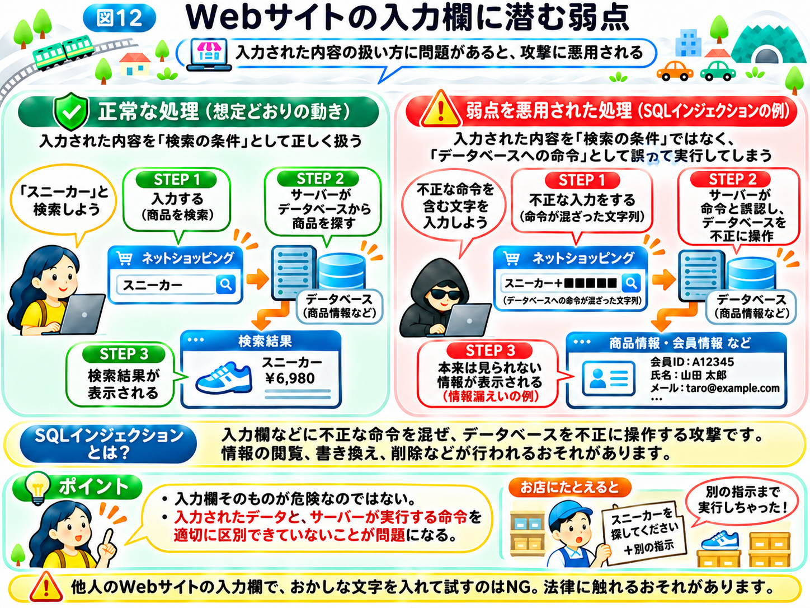

# Webサイトの弱点は、どうやって悪用される？

前節では、偽サイトでパスワードを盗む「フィッシング」や、流出したパスワードを悪用する攻撃について学びました。

これらは、利用者の行動やログイン情報を狙う攻撃でした。

では、利用者がだまされず、パスワードも盗まれていなければ、Webサイトは安全なのでしょうか？

実は、Webサイトやサーバーのプログラムそのものに弱点があると、そこを悪用されることがあります。図9の②「弱点から侵入する」にあたる攻撃です。

## プログラムにも、壊れた鍵や裏口のような弱点がある

「インターネットの仕組み」では、インターネットを街の道路網、Webサイトをお店にたとえました。

お店では、正面の入口からお客さんを迎え、従業員だけが入れる部屋には鍵をかけるなど、場所によって入れる人を制限しています。

しかし、もし従業員専用の部屋の鍵が壊れていたらどうでしょうか？

本来は入れない人が、中に入れてしまうかもしれません。

Webサイトでも、これと似た問題が起こることがあります。

プログラムの作り方や設定に不備があると、本来は許されていない操作ができたり、見られないはずの情報を見られたりする場合があるのです。

「インターネットの仕組み」でも学んだように、こうしたセキュリティ上の弱点を「脆弱性（ぜいじゃくせい）」と呼びます。

## Webサイトの裏側では、どんな処理が行われている？

例えば、ネットショッピングのWebサイトを考えてみましょう。

私たちが商品を検索すると、画面には商品名や価格、在庫状況などが表示されます。

こうした情報は、Webサイトの裏側にある「データベース」に保存されていることがあります。

**データベースとは、商品情報や会員情報など、たくさんのデータを整理して保存し、必要なときに取り出せるようにした仕組み**です。

お店にたとえるなら、商品名や価格、在庫数などがまとめられた管理台帳のようなものです。

例えば、利用者が検索欄に「スニーカー」と入力すると、サーバーはデータベースから条件に合う商品を探し、検索結果を返します。

つまり、利用者が入力した内容をもとに、Webサイトの裏側でさまざまな処理が行われているのです。

「インターネットの仕組み」の乗換案内のサーバーも、時刻表や路線のデータをデータベースに保存し、そこから経路を計算しています。

## 入力欄が、攻撃のきっかけになることもある

ここで、商品を検索する入力欄について考えてみましょう。

通常、検索欄には「スニーカー」や「バッグ」など、探したい商品の名前を入力します。

サーバーはその文字を検索条件として受け取り、商品を探します。

しかし、プログラムに弱点があると、入力された文字を単なる検索条件ではなく、データベースに対する命令の一部として扱ってしまう場合があります。

これは、お店の従業員が、お客さんから渡されたメモを読んで商品を探す場面に似ています。

本来は「スニーカーを探してください」というお願いだけを受け付けるはずなのに、メモに書かれた別の指示まで、従業員がそのまま実行してしまうような状態です。

このような弱点を悪用し、データベースへの命令を不正に変えてしまう攻撃を、**「SQLインジェクション（エスキューエル・インジェクション）」**と呼びます。

SQLとは、データベースから情報を取り出したり、データを変更したりするときに使われる言葉のようなものです。

攻撃が成功すると、本来は見られない情報を取り出されたり、保存されているデータを書き換えられたりするおそれがあります。

ただし、入力欄があるだけで危険というわけではありません。問題は、入力された内容をプログラムが適切に扱えていないことにあります。

ここで1つ、大切な注意があります。他人のWebサイトの入力欄に、わざとおかしな文字を入れて反応を確かめるような行為は、不正アクセス禁止法などの法律に触れるおそれがあります。「攻撃者は、どうやって狙う相手を見つける？」のページでも学んだように、こうした調査が許されるのは、相手から許可を得た場合だけです。興味があっても、決して試さないでください。

## 弱点は、入力欄だけにあるわけではない

脆弱性には、さまざまな種類があります。

例えば、ログインしていない人が他人の情報を見られてしまう、権限のない人が管理者向けの機能を操作できてしまう、といった問題もあります。

また、使っているソフトウェアに不具合が見つかり、後から脆弱性として公表されることもあります。

そのため、開発者はプログラムを安全に作るだけでなく、運用を始めたあとも弱点がないかを確認し、必要な修正を続けることが大切です。

なお、脆弱性が存在するからといって、必ず攻撃が成功するわけではありません。実際の被害は、弱点の内容やシステムの設定、ほかの対策の有無などによって変わります。

## 脆弱性が見つかったら、どうする？

ソフトウェアの脆弱性が見つかると、多くの場合、開発元が修正版を公開します。

このような不具合や弱点を修正するための更新を、「セキュリティアップデート」と呼びます。

また、弱点を修正するためのプログラムや修正内容を「パッチ」と呼ぶこともあります。

街のお店にたとえるなら、壊れた鍵を新しい鍵に交換したり、誰でも入れる裏口を修理したりするようなものです。

脆弱性は、Webサイトだけでなく、私たちが普段使うスマホやアプリにも見つかります。更新を行うことが大切なのは、こうしたセキュリティ上の弱点が修正されることがあるためです。

## フィッシングと脆弱性の悪用の違い

ここまで見てきたように、Webサイトの弱点を悪用されると、情報を盗まれたり、データを書き換えられたりするおそれがあります。弱点の種類によっては、サーバーを不正に操作される場合もあります。

前節のフィッシングと比べると、狙う場所が違います。

**フィッシングは利用者をだます攻撃、脆弱性の悪用はプログラムや設定の弱点を狙う攻撃**です。

フィッシングは、利用者が気をつけることで防げる部分が大きい攻撃です。一方、脆弱性の悪用は、利用者がどれだけ注意していても、Webサイトを作る側・運営する側が対策しなければ防げません。

では、攻撃者が実際にサーバーへ侵入した場合、そのあと何が起こるのでしょうか？

次節では、**「サーバーに侵入されると、何が起こる？」**を見ていきましょう。

