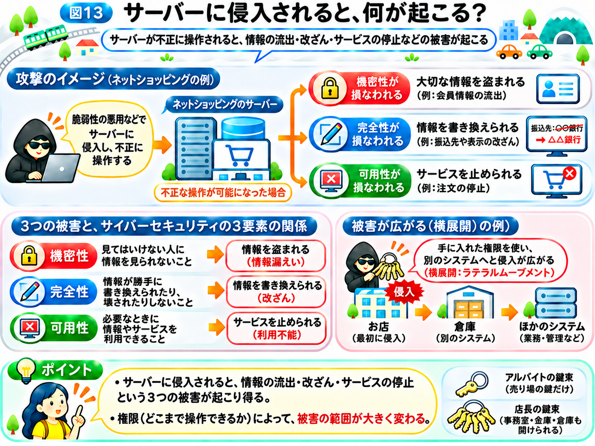

# サーバーに侵入されると、何が起こる？

前のページでは、Webサイトやサーバーのプログラムにある弱点「脆弱性」が、攻撃者に悪用される仕組みを学びました。

例えば、SQLインジェクションでは、入力された文字をサーバーが誤って命令として扱ってしまい、本来は見られない情報を取り出されることがあります。

では、攻撃者がサーバーに侵入したり、不正に操作できるようになったりすると、どのような被害が起こるのでしょうか？

実は、被害は1つの情報が盗まれるだけでは終わらない場合があります。

## サーバーの中には、大切な情報が保管されている

第1章では、サーバーを、利用者からの依頼を受け取り、必要な情報を返す仕組みとして紹介しました。

例えば、ネットショッピングのサーバーでは、商品情報だけでなく、利用者の名前や住所、注文履歴などを扱っていることがあります。

こうした情報は、データベースなどに保存されています。

第1章から使っている「インターネットの街」にたとえるなら、お店の奥にある事務室や金庫のようなものです。

お客さんが入れる売り場とは違い、事務室や金庫には従業員しか見られない書類や、大切な管理台帳が保管されています。

もし悪意のある人がこうした場所に入り込んだら、何が起こるでしょうか？

## 機密性が損なわれる：大切な情報を盗まれる

まず考えられるのが、情報の流出です。

例えば、攻撃者が会員情報を扱うシステムを不正に操作できるようになり、名前やメールアドレスなどを盗み出す場合があります。

これは、街のお店にたとえるなら、事務室の管理台帳を勝手に持ち出されるようなものです。

これは、第1章で学んだサイバーセキュリティの3要素のうち、**「機密性」**が損なわれた状態です。

盗まれた情報が別の攻撃に使われることもあります。

例えば、流出したメールアドレスに偽のメッセージを送ったり、パスワードが知られた場合には、前に学んだ「パスワードリスト攻撃」で、別のサービスへの不正ログインを試みたりすることがあります。

つまり、**1つのサーバーで起きた情報漏えいが、別のサービスの利用者にも影響を与える場合がある**のです。

## 完全性が損なわれる：情報を書き換えられる

攻撃者の目的は、情報を盗むことだけではありません。

保存されている情報を、勝手に変更する場合もあります。

例えば、ネットショッピングの商品の価格や振込先の情報が不正に書き換えられたら、利用者は誤った内容を信じてしまうかもしれません。

これは、お店の管理台帳に書かれた値段や振込先を、誰かが勝手に書き換えるようなものです。

また、Webサイトの表示内容が改ざんされ、偽の案内や不正なリンクが掲載されることもあります。

こうした被害は、第1章で学んだサイバーセキュリティの3要素のうち、**「完全性」**が損なわれた状態です。

## 可用性が損なわれる：サービスを止められる

さらに、サーバーの設定やプログラムを不正に操作されると、サービスそのものが利用できなくなる場合があります。

例えば、ネットショッピングの注文を受け付けられなくなったり、会社の業務システムを使えなくなったりすることがあります。

お店にたとえるなら、レジや在庫管理の設備を壊され、営業できなくなるようなものです。

利用者にとっては、必要なときにサービスが使えないという被害になります。

これは、第1章で学んだ**「可用性」**が損なわれた状態です。

サービスを止める攻撃の代表例が、次のページで紹介する「ランサムウェア」です。

なお、前に紹介したDDoS攻撃もサービスを止める攻撃ですが、こちらは外部から大量の通信を送るもので、必ずしもサーバーへの侵入を必要としません。

## 1か所への侵入が、別の場所にも広がることがある

ここでもう1つ、注意したいことがあります。

企業では、1台のサーバーだけでなく、複数のサーバーや業務システムを組み合わせて利用していることがあります。

例えば、ネットショッピングのシステムと、商品の在庫を管理するシステムがつながっている場合です。

街のたとえでいえば、お店と倉庫が、従業員専用の通路でつながっているようなものです。

ここで大切になるのが「権限」です。権限とは、システムの中で「誰が、何をしてよいか」という許可のことです。

お店でたとえるなら、従業員が持つ鍵束のようなものです。アルバイトの鍵束では売り場の鍵しか開けられませんが、店長の鍵束なら、事務室も金庫も通路の先の倉庫も開けられます。

もし攻撃者が1つのシステムへ侵入し、店長の鍵束のように、ほかのシステムへアクセスできる権限まで手に入れてしまったら、その先にも被害が広がる可能性があります。

こうして、最初に侵入した場所から別のシステムへ不正にアクセスしていくことを、**「横展開（ラテラルムーブメント）」**と呼びます。

ただし、1か所へ侵入されたからといって、必ずほかのシステムにも侵入できるわけではありません。

システムごとにアクセスできる人を制限したり、ネットワークを分けたりすることで、被害の拡大を抑えられる場合があります。

## 被害の大きさは、奪われた権限で変わる

ここまで紹介した被害は、攻撃者が何を操作できるようになったかによって変わります。

例えば、データベースの一部を不正に読み取れたとしても、それだけでサーバー全体を自由に操作できるとは限りません。

アルバイトの鍵束を盗まれた場合と、店長の鍵束を盗まれた場合とでは、入られる部屋の数がまったく違うのと同じです。

大切なのは、**「どの弱点が悪用されたのか」「攻撃者にどこまでの権限を奪われたのか」によって、被害の範囲が変わる**ということです。

## 侵入による被害を整理しよう

ここまでの内容を、図13に沿って整理してみましょう。

**機密性：** 会員情報やメールアドレスなどを外部に持ち出される

**完全性：** 商品情報やWebサイトの表示を不正に変更される

**可用性：** システムを利用できない状態にされる

さらに、ほかのシステムへ不正なアクセスが広がると、被害が大きくなることがあります。

では、攻撃者がパソコンやサーバーに悪意のあるプログラムを入り込ませたら、どのようなことが起こるのでしょうか？

次のページでは、**「ウイルスやランサムウェアは何をする？」**を見ていきましょう。

