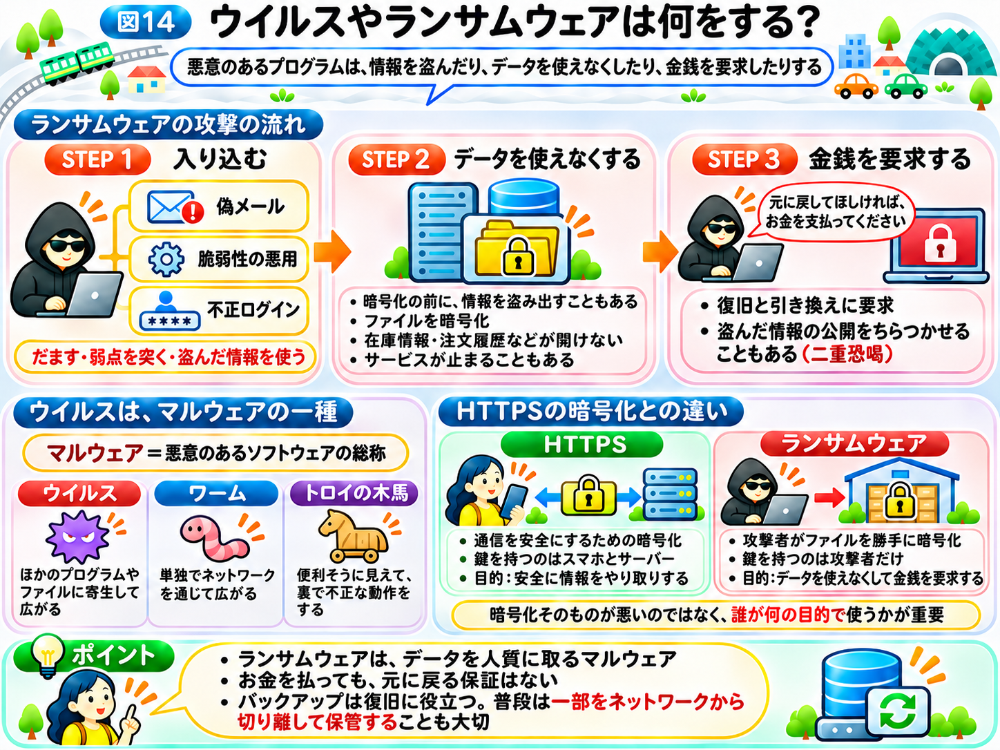

# ウイルスやランサムウェアは何をする？

前節では、攻撃者がサーバーへ侵入し、不正に操作できるようになると、情報を盗まれたり、書き換えられたり、サービスを止められたりすることを学びました。

では、攻撃者は、どのようにしてパソコンやサーバーを不正に操作するのでしょうか？

その方法の1つが、悪意のあるプログラムを入り込ませることです。

ニュースで耳にする「コンピューターウイルス」や「ランサムウェア」も、こうしたプログラムの仲間です。

## 悪意のあるプログラムを「マルウェア」と呼ぶ

まず、「マルウェア」という言葉を紹介します。

**マルウェアとは、情報を盗んだり、データを壊したり、システムを不正に操作したりする目的で作られた、悪意のあるソフトウェアの総称**です。

私たちが普段使っているアプリやプログラムは、便利な機能を提供するために作られています。

一方、マルウェアは、利用者やシステムに被害を与えることを目的としています。

「インターネットの仕組み」から使っている「インターネットの街」にたとえてみましょう。

お店にあるレジや在庫管理の機械は、営業を助けるための設備です。

しかし、悪意のある人が、こっそり不正な装置を取り付けたらどうでしょうか？

お客さんの情報を盗んだり、商品の管理台帳を書き換えたり、レジを使えなくしたりするかもしれません。

マルウェアも、これと似ています。

**本来は利用者のために動くコンピューターに、攻撃者の意図した不正な動作をさせる**のです。

## ウイルスとマルウェアは同じもの？

「マルウェア」と「ウイルス」は、同じ意味で使われることがありますが、厳密には違います。

マルウェアは、悪意のあるソフトウェア全体を指す言葉です。

その中の1つが「コンピューターウイルス」です。

コンピューターウイルスは、ほかのプログラムやファイルに寄生するように入り込み、自分自身をコピーして広がる性質を持つマルウェアです。

一方、ほかのプログラムに寄生せず、単独でネットワークを通じて広がる「ワーム」や、一見すると便利なソフトウェアのふりをして、裏で不正な動作をする「トロイの木馬」などもあります。

つまり、**ウイルスはマルウェアの一種ですが、すべてのマルウェアがウイルスというわけではありません。**

## マルウェアは、どうやって入り込む？

では、悪意のあるプログラムは、どのようにしてパソコンやサーバーに入り込むのでしょうか？

例えば、仕事で使っているパソコンに、「請求書を確認してください」というメールが届いたとします。

添付ファイルを開いたり、メールに書かれたリンクから不審なソフトウェアをダウンロードしたりすることで、マルウェアが実行されてしまう場合があります。

これは、「パスワードは、どうやって盗まれる？」のページで学んだ、取引先を装った偽メールと同じ手口です。利用者をだます攻撃は、パスワードを盗むだけでなく、マルウェアを入り込ませるためにも使われます。

また、メールだけが侵入経路ではありません。

前節までに学んだように、ソフトウェアの脆弱性を悪用されたり、盗まれたログイン情報を使って不正にアクセスされたりして、マルウェアを設置される場合もあります。

つまり、**人をだます攻撃と、システムの弱点を狙う攻撃のどちらも、マルウェアを入り込ませるきっかけになり得る**のです。

ただし、メールの添付ファイルを開けば必ず感染するわけではありません。被害が起こるかどうかは、ファイルの内容や端末の設定、セキュリティ対策などによって異なります。

## ランサムウェアは、データを使えなくする

マルウェアの中でも、企業や病院などに大きな被害を与えることがあるのが「ランサムウェア」です。

ランサムウェアの「ランサム（ransom）」は、英語で「身代金」を意味します。

**ランサムウェアとは、ファイルを暗号化するなどして使えなくし、元に戻すことなどと引き換えに金銭を要求するマルウェア**です。

例えば、ネットショップを運営する会社のパソコンやサーバーが、ランサムウェアの被害を受けたとします。

商品の在庫情報や注文履歴などが暗号化され、従業員が内容を読めなくなってしまいます。

これでは、注文を確認したり、商品を発送したりすることが難しくなります。

ここで、攻撃者から次のような要求が届くことがあります。

「データを元に戻してほしければ、お金を支払ってください」

街のお店にたとえるなら、悪意のある人がお店の金庫や倉庫に勝手に鍵をかけ、鍵を返す代わりにお金を要求するようなものです。

ただし、お金を支払っても、データが元に戻る保証はありません。さらに、支払ったお金が、攻撃者の次の攻撃の資金になってしまうおそれもあります。

## HTTPSの暗号化と、ランサムウェアの暗号化は何が違う？

ここで、「インターネットの仕組み」の「HTTPS」を思い出してください。

HTTPSでも「暗号化」という言葉が登場しました。

では、HTTPSの暗号化と、ランサムウェアの暗号化は同じなのでしょうか？

どちらも情報を読みにくい形へ変える技術を利用していますが、**目的と、誰が鍵を管理しているかが違います。**

HTTPSでは、スマホとサーバーが安全に情報をやり取りするために暗号化を利用します。「インターネットの仕組み」で学んだように、箱を開ける鍵を持っているのは、スマホとサーバーだけです。

一方、ランサムウェアでは、攻撃者がファイルを勝手に暗号化し、正当な利用者がデータを使えない状態にします。このとき、鍵を持っているのは攻撃者だけです。

街のたとえでいえば、HTTPSは大切な荷物を守るために自分たちで鍵をかけること、ランサムウェアは他人が勝手に倉庫へ鍵をかけ、その鍵を持ち去ってしまうことです。

つまり、**暗号化という技術自体が悪いのではなく、誰が、何の目的で使うのかが重要**なのです。

これは、ハッキングとサイバー攻撃の違いにも通じる考え方です。

## データを盗んでから、金銭を要求する場合もある

ランサムウェアによる被害は、ファイルを使えなくすることだけとは限りません。

攻撃者が、暗号化する前に顧客情報や社内資料を盗み出すこともあります。

そして、「お金を支払わなければ、盗んだ情報を公開する」と脅す場合があります。

このように、データを使えなくすることに加えて、情報の公開をちらつかせて金銭を要求する手口を「二重恐喝」と呼びます。

前節で学んだサイバーセキュリティの3要素で考えると、情報を盗むことは「機密性」、データを使えなくすることは「可用性」を脅かします。

## マルウェアの被害を減らすには？

マルウェアへの対策は、1つだけでは十分ではありません。

例えば、不審なメールのリンクや添付ファイルを安易に開かないこと、スマホやパソコンのソフトウェアを最新の状態に保つことが大切です。

また、重要なデータのコピーを別の場所にも保管する「バックアップ」は、ランサムウェアなどによってデータが使えなくなった場合の復旧に役立ちます。

ただし、ランサムウェアは、ネットワークでつながっているバックアップまで暗号化してしまうことがあります。そのため、バックアップの一部は、普段はネットワークから切り離した場所に保管しておくことが大切です。

ただし、バックアップがあれば情報漏えいまで防げるわけではありません。

このように、**感染を防ぐ対策と、被害が起きたあとに復旧するための対策を組み合わせること**が重要です。

具体的な対策は、「セキュリティ対策」で詳しく紹介します。

では、こうしたサイバー攻撃が、ネットショップだけでなく、病院や交通機関などの社会を支えるサービスに起こったら、どのような影響があるのでしょうか？

次節では、**「社会を止めるサイバー攻撃とは？」**を見ていきましょう。

