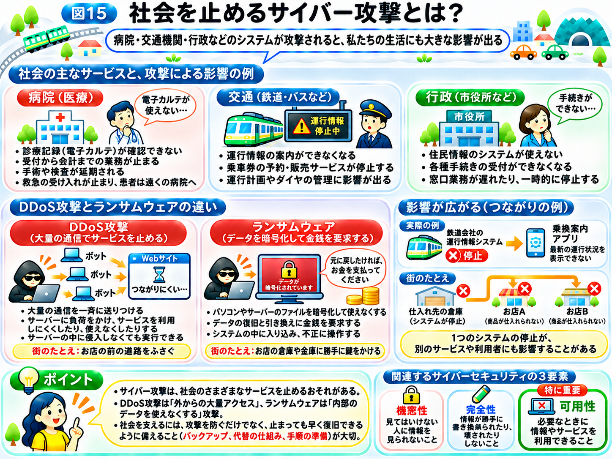

# 社会を止めるサイバー攻撃とは？

前のページでは、ランサムウェアによってデータが使えなくなり、企業の業務が止まることがあると学びました。

では、こうした攻撃が、ネットショッピングの会社ではなく、病院や鉄道会社、市役所などで起こったらどうなるでしょうか？

私たちが普段利用している社会のサービスも、多くのコンピューターやネットワークによって支えられています。

そのため、サイバー攻撃は、パソコンの画面の中だけでなく、私たちの日常生活にも影響を与えることがあるのです。

## 社会のさまざまな場所で、インターネットやシステムが使われている

例えば、病院では患者の情報や診療記録を管理するために、コンピューターが使われています。

鉄道会社では、乗車券の予約や運行情報の案内など、さまざまな業務にシステムが使われています。

市役所でも、住民情報の管理や各種手続きの受付などにコンピューターが欠かせません。

これらのシステムは、必ずしもすべてがインターネットに直接つながっているわけではありません。

しかし、組織の内部ネットワークや、外部との情報のやり取りに使う仕組みが攻撃を受けると、サービスや業務に影響が出る場合があります。

つまり、**社会を支える仕組みの多くが、コンピューターの安全な動作に依存している**のです。

## 病院が攻撃されたら、何が起こる？

例えば、ある病院がランサムウェアの被害を受けたとします。

多くの病院では、患者の診療記録を「電子カルテ」というシステムで管理しています。

電子カルテには、これまでの病気やけがの記録、飲んでいる薬、薬のアレルギー、血液検査やレントゲンの結果などがまとめて保存されています。

このシステムが使えなくなると、医師や看護師は、目の前の患者がどんな薬を飲んでいるのか、前回の検査結果がどうだったのかを、すぐに確認できなくなります。

さらに、薬の処方や検査の依頼、診察の予約、会計なども、システムを通じて行われていることがあります。そのため、診察そのものだけでなく、受付から会計までの流れ全体が止まってしまうおそれがあります。

### 患者には、どんな影響がある？

患者にとっては、まず診察の待ち時間が大幅に長くなります。

予定していた手術や検査が延期されたり、新しい患者の受け入れや救急患者の受け入れを一時的に止めざるを得なくなったりすることもあります。その場合、患者は遠くの別の病院へ行かなければならなくなります。

また、飲んでいる薬やアレルギーの記録をすぐに確認できない状態では、医療スタッフは患者本人への聞き取りなどで情報を補う必要があり、普段よりも慎重な確認が求められます。

さらに、攻撃者が暗号化の前に情報を盗み出していた場合は、病気や治療の記録といった、特に他人に知られたくない情報が流出するおそれもあります。

### 病院には、どんな影響がある？

病院では、紙の記録を使うなど、緊急時に備えた手順が用意されている場合もあります。

それでも、普段はシステムで行っている記録や処方、会計を手作業で行うことになり、医師や看護師、事務職員には大きな負担がかかります。

診療を制限すれば、その間の収入も減ります。さらに、システムの調査や復旧、作り直しには、多くの時間と費用がかかります。

情報が流出した場合には、患者への説明や対応も必要になり、病院への信頼にも影響します。

実際に国内でも、ランサムウェアの被害を受けた病院が、長期間にわたって診療を制限せざるを得なくなった事例があります。

これは、サイバー攻撃が単なるデータの問題ではなく、人々の暮らしや命にも関わることを示しています。

## 大量の通信でサービスを止める「DDoS攻撃」

ここで、第1章に登場した「DDoS（ディードス）攻撃」を思い出しましょう。

DDoS攻撃とは、**たくさんのコンピューターなどから一斉に大量の通信を送り、Webサイトやサービスを利用しにくくしたり、使えなくしたりする攻撃**です。

第1章では、街の道路が大勢の車でふさがれる様子にたとえました。

例えば、乗換案内サイトに大量の通信が押し寄せ、サーバーが処理しきれなくなったとします。

その結果、利用者が検索しても画面が表示されなかったり、検索結果が返ってこなかったりすることがあります。

重要なのは、**DDoS攻撃では、攻撃者がサーバーの中に侵入しなくても、外からサービスを妨害できる**ということです。

また、DDoS攻撃に使われるコンピューターの中には、マルウェアに感染して、持ち主が知らないうちに攻撃者に操られているものもあります。こうしたコンピューターは「ボット」と呼ばれます。

## DDoS攻撃とランサムウェアは、何が違う？

どちらもサービスを止めてしまう可能性がありますが、その仕組みは違います。

DDoS攻撃では、大量の通信を送りつけることで、サーバーやネットワークに負担をかけます。

一方、ランサムウェアでは、パソコンやサーバーのファイルを使えなくするなどして、業務を妨害します。

「インターネットの街」にたとえてみましょう。

**DDoS攻撃は、お店の前の道路を大勢でふさいで、本来のお客さんがたどり着けなくなるようなものです。**

それに対して、**ランサムウェアは、お店の倉庫や金庫に勝手に鍵をかけられ、従業員が仕事をできなくなるようなものです。**

外の道路をふさいで利用を妨害するのか、お店の中のデータやシステムを使えなくするのかという違いがあります。

ただし、実際の攻撃では複数の手口が組み合わされることもあります。

## サイバー攻撃の影響は、別の場所にも広がる

ここでもう1つ、考えておきたいことがあります。

例えば、ある鉄道会社の運行情報を提供するシステムが停止したとします。

すると、その情報を利用している乗換案内サービスでも、最新の運行状況を表示できなくなるかもしれません。

これは、1つのサービスが、別のサービスの情報や仕組みに支えられているためです。

街のたとえでいえば、仕入れ先の倉庫が止まると、そこから商品を仕入れているお店も、棚に商品を並べられなくなるようなものです。

私たちが普段使っているWebサイトやアプリも、別の会社が提供するサービスとつながっていることがあります。

そのため、**1つのシステムの停止が、別のサービスや、その利用者にまで影響を与える場合がある**のです。

## 社会を支えるために大切な「可用性」

第1章では、サイバーセキュリティの3要素として「機密性」「完全性」「可用性」を学びました。

ここまで紹介したようなサービス停止は、特に「可用性」に関わる問題です。

**可用性とは、必要なときに情報やサービスを利用できること**でした。

例えば、病院で必要な診療記録を確認できること、鉄道の運行情報を調べられること、市役所で必要な手続きを行えることも、可用性に関わります。

ただし、情報を盗まれないことや、データを勝手に書き換えられないことも重要です。

しかし、社会を支えるサービスでは、**必要なときに使える状態を保つこと自体が、人々の生活を守ることにつながる**のです。

## 社会を止めないためには？

こうした被害を小さくするには、攻撃を防ぐだけでなく、攻撃を受けてもサービスを続けたり、早く復旧したりできるように備える必要があります。

例えば、重要なデータのバックアップを保管すること、システムの一部が停止しても別の仕組みで対応できるようにすること、緊急時の業務手順を決めておくことなどです。

また、DDoS攻撃に対しては、大量の不正な通信を検知・制限する仕組みなどが使われます。

つまり、**サイバーセキュリティは、攻撃を防ぐだけでなく、被害が起きても社会のサービスを支え続けるための取り組み**でもあるのです。

では、さまざまな対策があるにもかかわらず、なぜサイバー攻撃を完全になくすことは難しいのでしょうか？

次のページでは、**「なぜ、サイバー攻撃を完全には防げない？」**を考えていきましょう。

