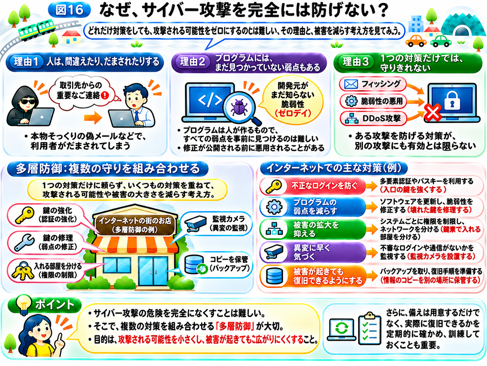

# なぜ、サイバー攻撃を完全には防げない？

ここまで、さまざまなサイバー攻撃の仕組みを学んできました。

フィッシングでは利用者がだまされ、SQLインジェクションではプログラムの弱点が悪用されます。また、ランサムウェアによってデータが使えなくなったり、DDoS攻撃によってサービスが停止したりすることもあります。

では、こうした攻撃を防ぐために、すべての弱点を修正し、十分なセキュリティ対策を行えば、もう安心なのでしょうか？

残念ながら、サイバー攻撃の危険を完全になくすことは難しいのが現実です。

その理由を、これまでの「インターネットの街」のたとえを使って考えてみましょう。

## 理由1　人は、間違えたり、だまされたりする

例えば、お店の建物に頑丈な鍵を取り付け、関係者以外は入れないようにしたとします。

しかし、店員さんが配達業者を装った人を信用し、自分から裏口を開けてしまったらどうでしょうか？

どれだけ丈夫な鍵があっても、悪意のある人を招き入れてしまうかもしれません。

インターネットでも同じようなことが起こります。

例えば、従業員が本物そっくりの偽メールを信じてパスワードを入力したり、不審な添付ファイルを開いてしまったりする場合があります。

「パスワードは、どうやって盗まれる？」のページで学んだフィッシングは、まさに人の思い込みや判断を狙う攻撃でした。

確かに、利用者が注意することは大切です。しかし、攻撃者は本物らしい文章や画面を作り、相手をだまそうとします。

そのため、**人が注意することだけに頼っていては、すべての攻撃を防ぐことはできません。**

## 理由2　プログラムには、まだ見つかっていない弱点もある

これまでに、プログラムや設定に存在するセキュリティ上の弱点を「脆弱性」と呼ぶことを学びました。

ソフトウェアの開発者は、安全に動くようにプログラムを作り、問題が見つかれば修正を行っています。

しかし、プログラムは人が作るものであり、複雑なシステムでは、あらゆる問題を事前に見つけることは難しいものです。

例えば、お店を建てるときに入口や窓の鍵を確認していても、営業を始めたあとで、思いがけない場所に弱点が見つかるかもしれません。

コンピューターの世界でも、まだ開発元が知らない脆弱性が存在することがあります。

こうした、開発元がまだ把握していない脆弱性などを悪用する攻撃は「ゼロデイ攻撃」と呼ばれることがあります。

名前の由来は、修正するための猶予が「0日」であるという考え方です。

ゼロデイ攻撃が行われる時点では、まだ修正版が公開されていません。そのため、ソフトウェアをこまめに更新していても、それだけでは防げないのです。

大切なのは、**ソフトウェアを最新の状態に保っていても、未知の弱点による危険が残る場合がある**ということです。

## 理由3　1つの対策だけでは、守りきれない

ここまでに学んだ攻撃は、狙う場所も方法も異なっていました。

例えば、HTTPSを使えば通信の盗み見や改ざんの危険を小さくできます。

しかし、HTTPSだけでは、本物そっくりの偽サイトに利用者がパスワードを入力してしまうことまでは防げません。

また、強いパスワードを設定していても、サーバーのプログラムに脆弱性があれば、別の方法で攻撃される可能性があります。

さらに、パソコンを安全に保っていても、外部から大量の通信が送りつけられるDDoS攻撃によって、サービスが利用しにくくなることがあります。

つまり、**ある攻撃を防げる対策が、別の攻撃にも有効とは限らない**のです。

## 複数の対策を組み合わせる「多層防御」

そこで重要になるのが、**「多層防御（たそうぼうぎょ）」**という考え方です。

多層防御とは、1つの対策だけに頼らず、複数の異なる対策を組み合わせてシステムや情報を守ることです。

「インターネットの街」のお店で考えてみましょう。

大切な商品を守るために、入口の鍵だけを取り付けるのではなく、壊れた鍵はすぐに修理し、従業員の鍵束で入れる部屋を分け、監視カメラを設置し、重要な書類のコピーを別の場所に保管したりします。

そうすれば、仮に入口の鍵が破られても、ほかの対策によって被害を小さくできるかもしれません。

インターネットでも、同じ考え方が使われています。

例えば、次のような対策を組み合わせます。

- **不正なログインを防ぐ：** 多要素認証やパスキーを利用する（入口の鍵を強くする）
- **プログラムの弱点を減らす：** ソフトウェアを更新し、脆弱性を修正する（壊れた鍵を修理する）
- **被害の拡大を抑える：** システムごとに権限を制限し、ネットワークを分ける（鍵束で入れる部屋を分ける）
- **異変に早く気づく：** 不審なログインや通信がないかを監視する（監視カメラを設置する）
- **被害が起きても復旧できるようにする：** バックアップを取り、復旧手順を準備する（書類のコピーを別の場所に保管する）

ここで大切なのは、どれか1つが突破されても、別の対策が働くようにしておくことです。

ただし、多層防御を行えば、必ず攻撃を防げるというわけではありません。

**攻撃される可能性を小さくし、被害が起きても広がりにくくすることが目的**なのです。

## 攻撃を防ぐことだけが、セキュリティではない

前のページでは、社会を支えるサービスを止めないために、バックアップや代わりの仕組み、緊急時の手順を用意しておくことを学びました。

ここで大切なのは、こうした備えを「用意しておくだけ」で終わらせないことです。

バックアップを取っていても、いざというときに元に戻せなければ意味がありません。緊急時の手順を決めていても、誰も手順を知らなければ、実際には動けません。

そのため、企業や病院などでは、バックアップから実際に復旧できるかを定期的に確かめたり、システムが止まったことを想定した訓練を行ったりしています。

第1章で学んだ「可用性」を守るためには、止まらないように備えることと、止まっても復旧できるように備えることの両方が必要なのです。

## 第2章のまとめ｜攻撃の仕組みを知れば、守り方が見えてくる

この章では、攻撃者がどのような手口で人やシステムを狙うのかを学びました。

攻撃者は、公開情報を集めて下調べをしたり、人の思い込みを突いて偽サイトでパスワードを盗んだり、プログラムの弱点を悪用したりします。

さらに、マルウェアやDDoS攻撃によって、企業の業務や社会を支えるサービスに影響を与えることもあります。

ここまでの内容からわかるのは、**サイバー攻撃にはさまざまな入り口があり、1つの対策だけですべてを防ぐことは難しい**ということです。

しかし、攻撃の仕組みを理解すれば、それぞれの危険に対して、どのような対策が必要なのかを考えられるようになります。

では、私たちが普段使っているスマホやWebサービスを守るために、具体的には何をすればよいのでしょうか？

次の第3章では、**「自分を守るセキュリティ対策」**として、今日から実践できる方法を紹介します。

