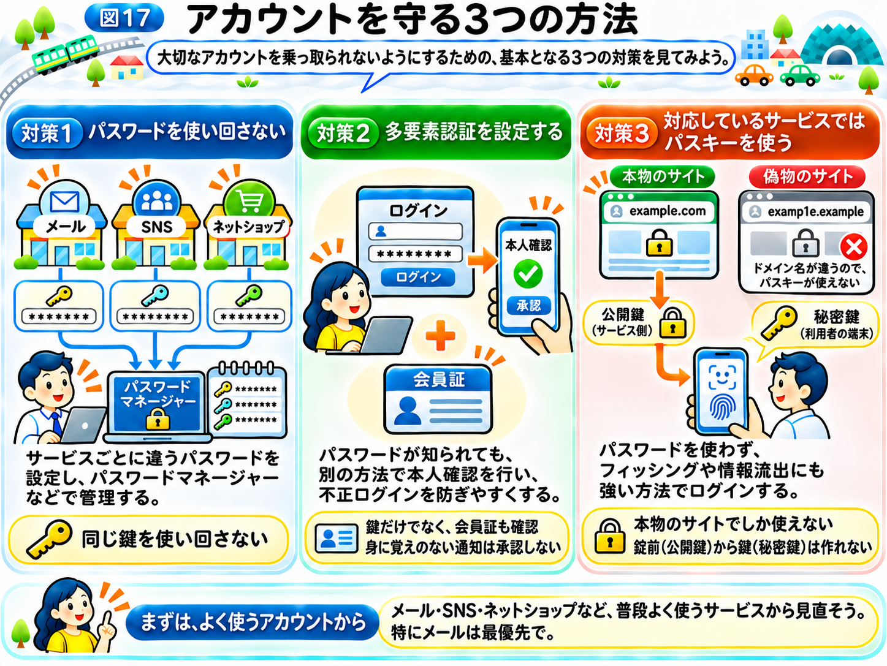

# パスワードとログインを守るには？

前の章では、攻撃者が偽サイトを使ってパスワードを盗んだり、流出したパスワードを使って別のサービスへ不正にログインしたりすることを学びました。

また、どれだけ注意していても、サイバー攻撃の危険を完全になくすことは難しいとわかりました。

では、私たちは何をすればよいのでしょうか？

まず取り組みたいのが、**自分のアカウントを守ること**です。

メールやSNS、ネットショッピングなど、私たちが普段利用するサービスには、大切な個人情報が保存されています。

こうした情報を守るために、ログインの仕組みを理解しておきましょう。

## パスワードは、お店の鍵のようなもの

「インターネットの仕組み」から使っている「インターネットの街」を思い出してください。

街には、ネットショップやSNS、メールなど、さまざまなお店があります。

それぞれのお店には、利用者だけが入れる部屋があり、その部屋を開けるための鍵が必要です。

インターネットでは、この鍵の役割を果たしてきたのが「パスワード」です。

例えば、メールアドレスとパスワードを入力すると、サービスは登録されている情報などと照らし合わせて、ログインを認めるか判断します。

このように、利用者が本人かどうかを確かめることを「認証」と呼びます。

ただし、パスワードには大きな弱点があります。

**本人ではなくても、正しいパスワードを知っていれば、ログインできてしまう場合がある**のです。

そのため、パスワードを盗まれにくくし、万が一知られてしまっても被害が広がらないようにする必要があります。

## 対策1　パスワードを使い回さない

「パスワードは、どうやって盗まれる？」のページでは、同じパスワードの使い回しが危険であることを学びました。

例えば、ネットショップとメールで同じパスワードを使っていたとします。

ネットショップからログイン情報が流出すると、その情報を使ってメールにも不正にログインされるかもしれません。

これは、ネットショップとメールのお店で、同じ鍵を使っているようなものです。

そのため、**サービスごとに異なる、推測されにくい長いパスワードを設定すること**が大切です。

しかし、利用するサービスが20個も30個もあったら、すべてのパスワードを覚えるのは大変です。

そこで役立つのが「パスワードマネージャー」です。

パスワードマネージャーは、さまざまなサービスのパスワードを安全に保存し、必要なときに入力を助けてくれる仕組みです。

SafariやChrome、スマホの機能などにも、パスワードを保存・管理する仕組みがあります。

こうした機能を使えば、サービスごとに長くて異なるパスワードを設定しやすくなります。

ただし、パスワードマネージャー自体や、それにアクセスするためのアカウントも、適切に保護する必要があります。

## 対策2　多要素認証を設定する

ここで、もう1つ考えてみましょう。

仮にパスワードが盗まれてしまっても、それだけではログインできない仕組みがあったらどうでしょうか？

そこで役立つのが、**「多要素認証（たようそにんしょう）」**です。

多要素認証とは、パスワードのような「知っている情報」に加えて、スマホなどの「持っているもの」や、指紋などの「本人の特徴」といった、異なる種類の情報を組み合わせて本人確認する仕組みです。

例えば、パスワードを入力したあと、自分のスマホに表示された確認画面で承認する方法があります。

街のお店にたとえるなら、部屋の鍵を開けるだけでなく、会員証も見せてもらうようなものです。

攻撃者がパスワードを知っていても、もう1つの確認を通過できなければ、ログインを防げる可能性が高くなります。

ただし、多要素認証も万能ではありません。

例えば、偽サイトにパスワードだけでなく確認コードまで入力してしまったり、身に覚えのないログイン承認を自分で許可してしまったりすると、不正ログインにつながる場合があります。

そのため、**自分でログインしていないのに確認通知が届いたら、承認しないこと**が大切です。

## 対策3　対応しているサービスではパスキーを使う

最近は、パスワードを使わずにログインできる「パスキー」という仕組みも広がっています。

例えば、対応しているサービスでは、スマホの顔認証や指紋認証、画面ロックなどを使ってログインできます。

なお、顔や指紋そのものをWebサイトに送っているわけではありません。

では、パスキーはどのような仕組みなのでしょうか？

パスキーでは、ログインのために、組になった2つの「鍵」を使います。ここでいう鍵は、人が覚える文字列ではなく、端末の中に保存されたデータのことです。

- **秘密鍵：** 自分の端末やパスキーを管理する仕組みの中で、安全に保管する鍵
- **公開鍵：** ログイン先のサービスに登録する鍵

ログインするとき、サービスは利用者の端末に本人確認のための問題を出します。

端末は秘密鍵を使って、その問題に対する答えを作ります。

サービスは、登録されている公開鍵を使い、正しい答えかどうかを確かめます。

このとき、**秘密鍵そのものをサービスへ送る必要はありません。**

街のお店にたとえるなら、公開鍵は、お店の部屋に取り付ける「錠前」です。秘密鍵は、その錠前に合う、自分だけが持っている鍵です。

お店には錠前を取り付けてもらうだけで、鍵そのものは渡しません。ログインのたびに、自分の鍵で錠前を開けられることを見せるだけです。

しかも、錠前を見ても、そこから鍵を作ることはできません。そのため、仮にサービスから公開鍵の情報が流出しても、攻撃者はそれを使ってログインすることはできないのです。

これは、サービスからの情報流出によってパスワードが知られてしまう危険とは、大きく違う点です。

## なぜ、パスキーはフィッシングに強いのか？

パスキーには、もう1つ大きな特徴があります。

それは、**ログイン先のWebサイトと結びついていること**です。

「インターネットの仕組み」では、Webサイトにはドメイン名というインターネット上の名前があると学びました。

ここでは説明用の架空の例として、本物のサービスのドメイン名が `example.com` だったとします。

攻撃者が `examp1e.example` のような、よく似た架空の名前の偽サイトを作ったらどうでしょうか？

パスワードの場合、利用者が偽サイトに入力してしまえば、攻撃者に知られるおそれがあります。

一方、パスキーは、対応する正しいWebサイトでしか認証に使えないように設計されています。

そのため、利用者が偽サイトを開いてしまっても、本物のサイト用のパスキーを使って、偽サイトにログインすることはできません。

つまり、**人が見間違えるような偽サイトに対しても、仕組みの側で不正なログインを防ぎやすい**のです。

ただし、パスキーを使っていれば、詐欺や端末の乗っ取りなど、あらゆる危険を防げるわけではありません。

## まずは、よく使うアカウントから守ろう

ここまで、3つの対策を紹介しました。

**対策1　パスワードを使い回さない**

サービスごとに違うパスワードを設定し、パスワードマネージャーなどで管理する。

**対策2　多要素認証を設定する**

パスワードが知られても、別の方法で本人確認を行い、不正ログインを防ぎやすくする。

**対策3　対応しているサービスではパスキーを使う**

パスワードを使わず、フィッシングや情報流出にも強い方法でログインする。

すべてのサービスを一度に見直す必要はありません。

まずは、メールやネットショッピング、SNSなど、よく使うサービスから確認してみましょう。

特にメールは、別のサービスのパスワードを再設定する際にも利用されるため、優先して守りたいアカウントです。

ここまでの対策は、主に「ログイン」を守るためのものでした。

では、スマホやアプリ自体に脆弱性があった場合は、どうすればよいのでしょうか？

次節では、**「スマホやアプリを安全に使うには？」**を見ていきましょう。

