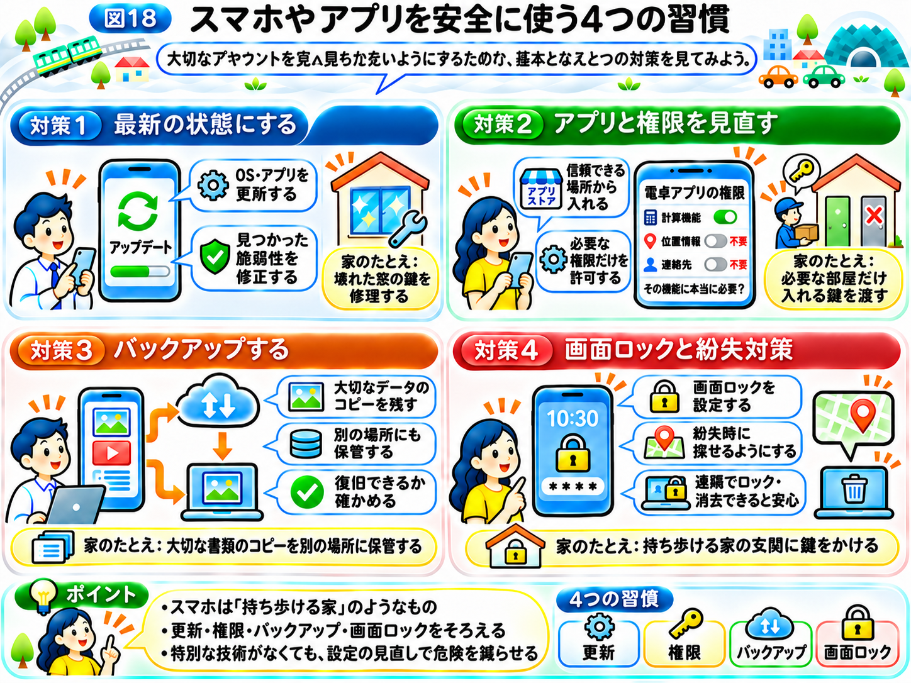

# スマホやアプリを安全に使うには？

前節では、パスワードの使い回しを防ぎ、多要素認証やパスキーを使って、アカウントを守る方法を学びました。

しかし、ログインを安全にしておけば、スマホやパソコンも安全なのでしょうか？

実は、そうとは限りません。

これまでの「インターネットの街」では、サービスをお店にたとえてきました。今回は、自分のスマホを「自分の家」にたとえてみましょう。

どれだけ玄関に強い鍵をかけていても、窓が壊れていたり、知らない人に合鍵を渡していたりすれば、別の場所から侵入されるかもしれません。

インターネットでも同じです。

スマホやアプリのプログラムに弱点があったり、不審なアプリに必要以上の権限を与えていたりすると、ログインとは別の方法で情報が盗まれる危険があります。

そこで今回は、スマホやアプリを安全に使うための4つの対策を紹介します。

## 対策1　スマホやアプリを最新の状態にする

スマホを使っていると、「ソフトウェアアップデートがあります」という通知が届くことがあります。

面倒だからと、後回しにしたことはないでしょうか？

実は、アップデートには新しい機能を追加するだけでなく、**セキュリティ上の弱点を修正する**という重要な役割があります。

「サイバー攻撃の仕組み」では、プログラムや設定に存在するセキュリティ上の弱点を「脆弱性」と呼ぶことを学びました。

また、PHPの脆弱性の事例では、PHPの実行処理に弱点が見つかり、開発元が修正したバージョンを公開したことを紹介しました。

スマホやアプリにも、同じような弱点が見つかることがあります。

例えば、スマホの中で動くプログラムに脆弱性があると、攻撃者にその弱点を悪用される可能性があります。

そこで開発者は、問題が見つかるとプログラムを修正し、安全性を高めた新しいバージョンを公開します。

「サイバー攻撃の仕組み」で学んだように、こうした弱点を修正するプログラムを「パッチ」と呼びます。

自分の家にたとえてみましょう。

家の窓の鍵が壊れていることに気づいたら、そのままにせず修理する必要があります。

アップデートは、まさに壊れた鍵を修理するようなものです。

しかし、開発者が修正版を公開しても、利用者が更新しなければ、古い弱点が残ったままになることがあります。

そのため、**スマホのOSやアプリは、セキュリティアップデートを速やかに適用すること**が大切です。

ここでいう「OS（オーエス）」とは、スマホやパソコンの基本的な動作を管理するソフトウェアです。

iPhoneのiOSや、AndroidスマホのAndroidなどがOSにあたります。

OSは、お店の裏側で設備全体を動かす基盤、アプリはその上で使う個別の設備のようなものです。

個別の設備だけを新しくしても、それらを動かす基盤に欠陥があれば、お店は安全とは限りません。これは、PHPの事例で見た「Webサイトの作り方に問題がなくても、お店の裏側で使う共通の設備に欠陥が見つかった」状況と同じです。

だからこそ、OSとアプリの両方を更新する必要があるのです。

なお、アップデートをすれば、未知の脆弱性を含めたすべての危険がなくなるわけではありません。

それでも、**すでに見つかり、修正された弱点を残さないこと**は、基本的なセキュリティ対策の1つです。

## 対策2　アプリは信頼できる場所から入れ、権限を確認する

スマホには、さまざまなアプリを追加できます。

地図アプリ、カメラアプリ、ゲーム、家計簿アプリなど、便利なものがたくさんあります。

しかし、すべてのアプリが安全とは限りません。

中には、便利なアプリを装い、利用者の情報を不正に集めようとするものもあります。

「サイバー攻撃の仕組み」では、便利なプログラムに見せかけて侵入するマルウェアを「トロイの木馬」と呼ぶことを学びました。

そのため、アプリは原則として、スマホの公式アプリストアなど、信頼できる場所から入れることが大切です。

ただし、公式アプリストアに掲載されていても、必ず安全とは限りません。開発元やアプリの説明なども確認しましょう。

さらに、アプリを使うときには、**「アクセス権限」**にも注意が必要です。

アクセス権限とは、アプリがスマホのどの機能や情報を利用してよいかを決める許可のことです。

例えば、地図アプリが現在地を表示するためには、位置情報へのアクセスが必要になる場合があります。

また、カメラアプリが写真を撮るには、カメラを使う許可が必要です。

一方、単純な電卓アプリが連絡先や位置情報へのアクセスを求めてきたら、どうでしょうか？

そのアプリの機能に本当に必要なのか、一度考える必要があります。

家にたとえるなら、配達員に荷物の受け渡しを頼むために、家じゅうの部屋を開けられる合鍵を渡す必要はありません。

必要な場所にだけ入れるようにすればよいのです。

スマホでも同じように、**アプリには必要な権限だけを与えること**が大切です。

これを「最小権限の原則」と呼びます。「サイバー攻撃の仕組み」で学んだ「アルバイトの鍵束と店長の鍵束」と同じく、必要な鍵だけを持たせるという考え方です。

すでに許可した権限も、スマホの設定から確認したり、変更したりできます。

使っていないアプリは削除し、必要以上の権限を与えていないか、定期的に見直しましょう。

## 対策3　大切なデータをバックアップする

ここまで、弱点を修正し、不審なアプリや不要な権限による危険を減らす方法を紹介しました。

しかし、それでも被害が起こる可能性は残ります。

例えば、ランサムウェアによってファイルが使えなくなったり、スマホが故障して写真が消えてしまったりするかもしれません。

そこで重要なのが、**「バックアップ」**です。

バックアップとは、大切なデータのコピーを、元のデータとは別の場所に保存しておくことです。

例えば、スマホの写真や連絡先などを、対応するクラウドサービスや外部の保存装置にバックアップする方法があります。

クラウドとは、インターネットを通じて利用できる、外部のコンピューターや保存サービスのことです。

自分の家にたとえてみましょう。

大切な書類を家に1部しか置いていなければ、火事や盗難で失ってしまうかもしれません。

しかし、書類のコピーを別の安全な場所にも保管しておけば、元の書類がなくなっても、コピーから内容を取り戻せる可能性があります。

バックアップは、それと同じ考え方です。

ただし、コピーを作っておけば必ず安心というわけではありません。

例えば、元のデータとバックアップが常に同じ状態になる仕組みでは、誤って消したデータがバックアップ側からも消えてしまう場合があります。

また、ランサムウェアなどの攻撃によって、接続されたバックアップまで被害を受ける可能性もあります。

そのため、重要なデータは、攻撃や故障の影響を同時に受けにくい場所にも保管することが大切です。

さらに、**バックアップから実際にデータを元に戻せるか**を確認しておく必要があります。

「サイバー攻撃の仕組み」で学んだ多層防御と同じように、攻撃を防ぐことだけでなく、被害が起きたあとに復旧できるようにしておくことも、セキュリティ対策の一部なのです。

## 対策4　画面ロックと紛失時の対策を設定する

最後に、スマホそのものをなくしたり、盗まれたりした場合への備えです。

スマホは、いわば「持ち歩ける家」です。落としてしまえば、家ごと誰かに拾われてしまうかもしれません。だからこそ、玄関の鍵にあたる画面ロックが大切になります。

スマホには、写真やメール、アプリのログイン情報など、大切な情報がたくさん保存されています。

もし、誰でもスマホを開ける状態だったら、拾った人に中身を見られてしまうかもしれません。

そのため、画面ロックを設定し、推測されにくい暗証番号などを使うことが大切です。

また、スマホには、紛失した端末を探したり、遠隔でロックやデータの消去を行ったりできる機能が用意されている場合があります。

こうした機能をあらかじめ設定しておくと、万が一のときに役立ちます。

ただし、端末の種類や設定によって利用できる機能は異なります。

## まとめ｜スマホやアプリを守る4つの習慣

今回学んだ対策を振り返りましょう。

**対策1　スマホやアプリを最新の状態にする**

OSとアプリを更新し、すでに見つかった脆弱性を修正する。

**対策2　アプリは信頼できる場所から入れ、権限を確認する**

不審なアプリを避け、必要以上の情報や機能へのアクセスを許可しない。

**対策3　大切なデータをバックアップする**

データのコピーを別の場所に保存し、実際に復旧できるかも確認する。

**対策4　画面ロックと紛失時の対策を設定する**

スマホをなくした場合でも、他人に情報を見られにくくする。

これらの対策は、特別な技術を持った人だけが行うものではありません。

普段使っているスマホの設定を少し見直すだけでも、危険を減らすことにつながります。

ただし、スマホやアプリを安全に保っていても、偽メールや偽サイトにだまされてしまう危険は残ります。

次節では、**「怪しいメールや偽サイトを見抜くには？」**を学びましょう。

