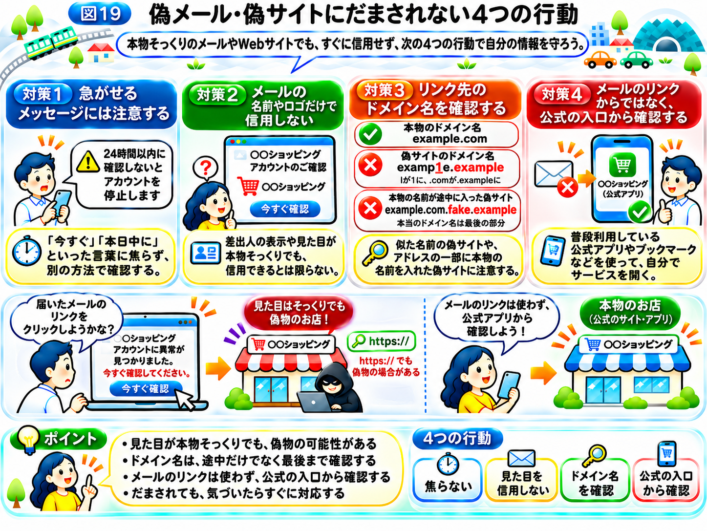

# 怪しいメールや偽サイトを見抜くには？

前節では、スマホやアプリを最新の状態に保ち、必要な権限だけを与え、バックアップや画面ロックを設定することを学びました。

しかし、スマホが安全でも、利用者自身がだまされてしまうことがあります。

例えば、こんなメールが届いたらどうでしょうか？

「お客様のアカウントに異常が見つかりました。24時間以内に確認しないと、サービスが停止されます。」

メールには、いつも利用しているネットショップの名前とロゴが表示され、「今すぐ確認する」というボタンがあります。

急いでボタンを押したくなるかもしれません。

しかし、そのメールが本物とは限りません。

「サイバー攻撃の仕組み」では、偽メールや偽サイトを使って、パスワードなどの情報を盗み取ろうとする「フィッシング」を学びました。

今回は、こうした攻撃にだまされないために、確認したいポイントと具体的な行動を紹介します。

## なぜ、偽メールや偽サイトにだまされるのか？

これまでの「インターネットの街」を思い出してください。

街には、ネットショップや銀行、SNSなど、さまざまなお店があります。

ある日、いつも利用しているお店から、手紙が届いたとします。

「あなたの会員証に問題が見つかりました。すぐにこちらのお店へ来てください。」

手紙には、お店の名前やロゴが印刷され、案内された場所には、普段のお店とそっくりな看板が立っています。

しかし、実はそのお店は、攻撃者が作った偽物でした。

利用者が本物だと思って会員証の情報や鍵を渡してしまうと、攻撃者に大切な情報を盗まれてしまいます。

インターネットでも、これと同じことが起こります。

攻撃者は、本物に似せたメールやWebサイトを作り、利用者にパスワード、クレジットカード情報、認証コードなどを入力させようとします。

これがフィッシング攻撃です。

重要なのは、**見た目が本物そっくりでも、本物であるとは限らない**ということです。

## 対策1　急がせるメッセージには注意する

フィッシングメールには、利用者を焦らせる文章が使われることがあります。

例えば、次のようなものです。

- 「本日中に手続きしないと、アカウントを停止します」
- 「不正利用が検出されました。今すぐ確認してください」
- 「荷物を届けられませんでした。再配達の手続きをしてください」
- 「未払い料金があります。至急お支払いください」

こうした文章を見ると、「早く対応しないと大変なことになる」と感じるかもしれません。

攻撃者は、その心理を利用します。

街のお店にたとえるなら、突然やってきた人から「今すぐ鍵を渡さないと、お店が使えなくなる」と言われるようなものです。

焦って行動すると、本当にその人がお店の関係者なのか、確かめる余裕がなくなります。

ただし、急ぎの連絡がすべて偽物というわけではありません。

大切なのは、**急ぐように求められたときこそ、別の方法で事実を確認すること**です。

## 対策2　メールの名前やロゴだけで信用しない

メールには、差出人の名前が表示されます。

例えば、「○○銀行」や「○○ショッピング」と書かれていれば、本物からの連絡だと思うかもしれません。

しかし、メールに表示される差出人名は、攻撃者でも本物に似せて設定できる場合があります。

さらに、差出人のメールアドレスまで本物に見せかける手口や、実際の企業アカウントが悪用される場合もあります。

そのため、名前やロゴ、差出人のアドレスだけで、本物だと判断することはできません。

街のお店でも、制服を着て名札を付けているからといって、必ず本物の店員とは限りません。

大切なのは、**相手が名乗っている名前だけで信用せず、連絡内容を別の方法で確かめること**です。

## 対策3　リンク先のドメイン名を確認する

「インターネットの仕組み」では、Webサイトには「ドメイン名」というインターネット上の名前があることを学びました。

「インターネットの仕組み」では、ドメイン名をお店の「店名」にたとえました。ドメイン名は、相手が本物かどうかを確かめるための重要な手がかりです。

ここでは説明用の架空の例として、本物のWebサイトが `example.com` というドメイン名を使っているとします。

攻撃者が `examp1e.example` のような、見た目の似た架空のドメイン名で偽サイトを作る可能性があります。

見比べると、「example」のアルファベットの「l」が数字の「1」に変わっています。さらに、最後の「.com」も「.example」に変わっています。

ほんの少しの違いなので、急いでいると気づかないかもしれません。文字の置き換えだけを探すのではなく、ドメイン名の先頭から末尾まで全体を確認することが大切です。

また、アドレスの途中に本物のサービス名が含まれていても、安心はできません。

例えば、`example.com.fake.example` というアドレスでは、`example.com` という文字が含まれていますが、実際のドメイン名は `fake.example` です。

つまり、**アドレスの一部に本物の名前が書かれていても、本物のサイトとは限らない**のです。

さらに、メールに表示されているリンクの文字と、実際に開かれるWebサイトのアドレスが異なる場合もあります。

ただし、スマホではアドレスが途中までしか表示されなかったり、短縮URLが使われたりするため、見ただけでは判断が難しいこともあります。

そのため、ドメイン名を確認することは大切ですが、それだけですべての偽サイトを見抜けるわけではありません。

## 「HTTPS」なら安全なサイトなの？

アドレス欄に `https://` や鍵の印が表示されていれば、本物のサイトなのでしょうか？　なお、スマートフォンではこれらが常に表示されるとは限りません。

答えは、**「いいえ」です。**

「インターネットの仕組み」で学んだように、HTTPSは、通信を鍵付きの箱に入れて運ぶような仕組みです。途中で中身を盗み見られる危険は小さくできます。

しかし、箱の届け先が偽物のお店だったら、鍵付きの箱はそのまま偽物のお店に届き、中身も開けられてしまいます。

実際、攻撃者が作った偽サイトでも、HTTPSを利用することはできます。

つまり、**「HTTPSで通信が保護されていること」と「Webサイト自体が信用できること」は別の話**なのです。

## 対策4　メールのリンクからではなく、公式の入口から確認する

ここまで、怪しいメールや偽サイトの特徴を紹介しました。

しかし、攻撃者の手口は年々巧妙になり、本物と偽物を見た目だけで判断することは難しくなっています。

そこで、最も大切にしたいのが、**メールやSMSに書かれたリンクを使わず、自分で公式のサービスを開いて確認すること**です。

例えば、ネットショップから「アカウントに問題があります」というメールが届いたとします。

その場合、メール内の「確認する」ボタンを押すのではなく、普段使っている公式アプリや、以前から登録しているブックマークからサービスを開きます。

そして、アカウントのお知らせや注文履歴などを確認します。

街にたとえるなら、知らない人に案内された場所へ向かうのではなく、普段から知っているお店へ直接行き、店員に確かめるようなものです。

公式の連絡先へ問い合わせる場合も、怪しいメールに書かれた電話番号ではなく、以前から確認できている公式の連絡先を利用しましょう。

なお、同じようなフィッシング攻撃は、SMSやSNSのメッセージ、QRコードなどを通じて行われることもあります。

**入口がどこであっても、案内された先を無条件に信用しないこと**が大切です。

また、前節で学んだパスキーを使っているサービスなら、偽サイトを開いてしまっても、本物のサイト用のパスキーは使えません。だまされにくい仕組みを選んでおくことも、フィッシングへの有効な備えです。

## もし、偽サイトに情報を入力してしまったら？

どれだけ注意していても、だまされてしまう可能性はあります。

大切なのは、気づいたあとに、できるだけ早く対応することです。

例えば、偽サイトにパスワードを入力してしまった場合は、そのサービスの公式アプリや公式サイトを自分で開き、パスワードを変更します。

同じパスワードを別のサービスでも使っていた場合は、そちらも変更する必要があります。

また、サービスに多要素認証が用意されていれば、有効にしましょう。

不審なログイン履歴や、知らない端末からのログインがないかも確認します。

クレジットカード情報を入力した場合は、カード会社の公式窓口へ連絡し、必要な対応を相談することが大切です。

不審なアプリをインストールしてしまった場合は、アプリを使い続けず、端末の安全確認や削除などの対応が必要になります。

職場のアカウントや業務用端末に関係する場合は、自分だけで判断せず、会社の情報システム担当者などに速やかに報告しましょう。

「サイバー攻撃の仕組み」の最後で学んだように、セキュリティは攻撃を防ぐことだけではありません。

攻撃を完全に防ぐことは難しくても、**被害に気づいたあと、すぐに対応することで、被害の拡大を抑えられる可能性があります。**

どう対応すればよいかわからない場合は、警察の相談窓口やフィッシングの報告窓口など、公的な相談先を利用することもできます。

## まとめ｜偽メールや偽サイトにだまされない4つの行動

今回学んだ対策を振り返りましょう。

**対策1　急がせるメッセージには注意する**

「今すぐ」「本日中に」といった言葉に焦らず、別の方法で確認する。

**対策2　メールの名前やロゴだけで信用しない**

差出人の表示や見た目が本物そっくりでも、信用できるとは限らない。

**対策3　リンク先のドメイン名を確認する**

似た名前の偽サイトや、アドレスの一部に本物の名前を入れた偽サイトに注意する。

**対策4　メールのリンクからではなく、公式の入口から確認する**

普段利用している公式アプリやブックマークなどを使って、自分でサービスを開く。

そして、万が一だまされてしまった場合は、速やかに適切な対応を取ることが大切です。

ここまでの「セキュリティ対策」では、アカウント、スマホ、そして利用者自身を守るための対策を学んできました。

最後のページでは、これまでの知識を振り返りながら、**今日から実践できるセキュリティ対策**を整理しましょう。

