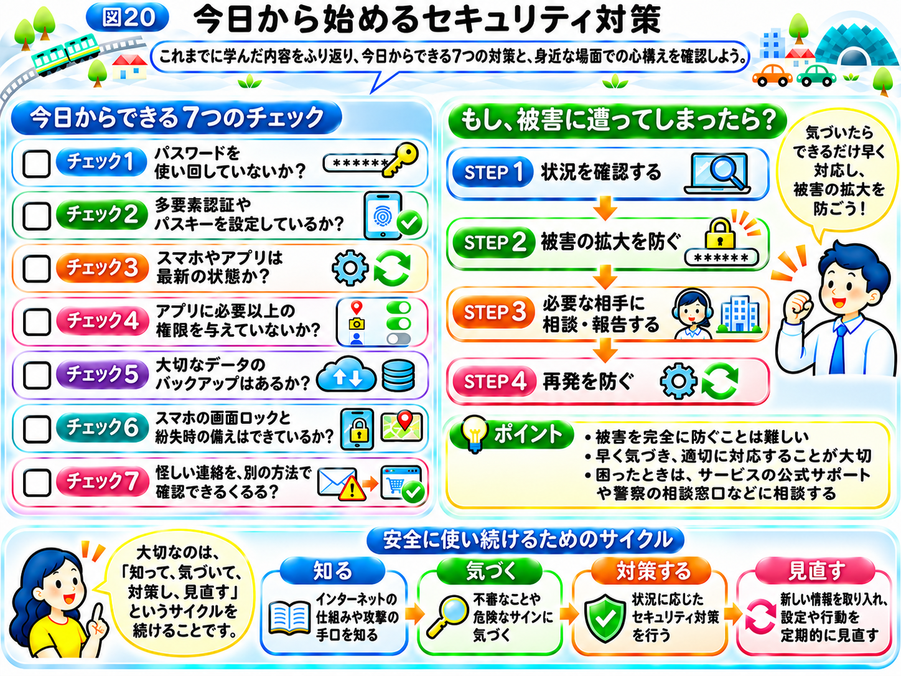

# 今日から始めるセキュリティ対策

ここまで、インターネットの仕組みから、サイバー攻撃の手口、そして具体的なセキュリティ対策まで学んできました。

最初は、Webサイトがどのように表示されるのか、私たちの情報がインターネットをどう移動するのか、想像しにくかったかもしれません。

しかし、インターネットを1つの「街」にたとえることで、その仕組みが少しずつ見えてきたのではないでしょうか。

道路を通って荷物が運ばれ、お店には名前と住所があり、建物の中ではさまざまなプログラムが動いています。そして、私たちが持ち歩くスマホは、いわば「自分の家」でした。

そして、便利な街には、偽物のお店や壊れた鍵、悪意のある人など、気をつけなければならない危険も存在します。

大切なのは、危険があるからといってインターネットを怖がることではありません。

**どのような仕組みで動いているのかを知り、危険に応じた対策を選べるようになること**です。

最後に、今日から実践できるセキュリティ対策を整理しましょう。

## まずは、この7つを確認しよう

どれも特別な技術を必要としない、基本的な対策です。

**チェック1　パスワードを使い回していないか？**

同じパスワードを複数のサービスで使っていると、1か所から情報が流出しただけで、別のアカウントまで狙われる可能性があります。

サービスごとに異なる、長くて推測されにくいパスワードを使い、必要に応じてパスワードマネージャーを活用しましょう。

**チェック2　多要素認証やパスキーを設定しているか？**

パスワードだけに頼らず、別の方法で本人確認することが大切です。

対応しているサービスでは、多要素認証やパスキーを利用しましょう。

特にメールのアカウントは、ほかのサービスのパスワード再設定にも使われるため、優先して保護したいものです。

**チェック3　スマホやアプリは最新の状態か？**

スマホのOSやアプリに、修正されていない脆弱性が残っていることがあります。

アップデートの通知を確認し、セキュリティに関する更新を速やかに適用しましょう。

自動更新の設定も役立ちます。

**チェック4　アプリに必要以上の権限を与えていないか？**

アプリが求める位置情報、カメラ、連絡先などへのアクセスが、本当に必要か確認しましょう。

使っていないアプリを削除し、許可した権限も定期的に見直すことが大切です。

**チェック5　大切なデータのバックアップはあるか？**

写真や書類などの大切なデータは、別の安全な場所にもコピーを保管しておきましょう。

バックアップがあるだけでなく、必要なときに元に戻せるか確認することも重要です。

**チェック6　スマホの画面ロックと紛失時の備えはできているか？**

画面ロックを設定し、推測されにくい暗証番号などを使いましょう。

端末を探す機能や、遠隔でロック・消去する機能が利用できる場合は、事前に設定しておくと安心です。

**チェック7　怪しい連絡を、別の方法で確認できているか？**

「今すぐ確認してください」「アカウントが停止されます」といったメッセージを受け取っても、焦ってリンクを開かないことが大切です。

普段使っている公式アプリやブックマークなどからサービスを開き、事実を確認しましょう。

リンクを開いてしまった場合でも、入力する前に、ドメイン名を最後まで確認しましょう。

## もし、被害に遭ってしまったら？

ここまで紹介した対策を行っていても、サイバー攻撃の危険を完全になくすことはできません。

第2章では、1つの対策だけに頼らず、複数の対策を組み合わせる「多層防御」を学びました。

そして、攻撃を防ぐだけでなく、被害に早く気づき、広がらないようにし、元の状態に戻すための備えも必要だと学びました。

これは、私たち個人にも当てはまります。

例えば、身に覚えのないログイン通知が届いたり、知らない取引が見つかったりしたら、放置しないことが大切です。

被害が疑われる場合は、次の順番で考えましょう。

**STEP 1　状況を確認する**

どのサービスで、何が起きたのかを確認します。

怪しいメールのリンクは使わず、公式アプリや信頼できる公式サイトから状況を調べましょう。

**STEP 2　被害の拡大を防ぐ**

不正ログインが疑われる場合は、公式の手順に従ってパスワードを変更し、不審なログイン状態を終了させるなどの対応を行います。

クレジットカードの不正利用が疑われる場合は、カード会社へ速やかに連絡しましょう。

**STEP 3　必要な相手に相談・報告する**

自分だけで対応が難しい場合は、サービスの公式サポートや警察の相談窓口などに相談します。

会社のアカウントや仕事用の端末に関する問題は、社内の担当者に速やかに報告しましょう。

**STEP 4　再発を防ぐ**

原因がわかったら、必要な設定を見直します。

パスワードの使い回しをやめる、多要素認証を有効にする、ソフトウェアを更新するなど、同じ被害を繰り返さないための対策につなげましょう。

ただし、実際に取るべき対応や順番は、被害の種類によって異なります。

不審なアプリのインストールや端末への侵入が疑われる場合などは、安全な別の端末を使って相談する必要があることもあります。

## セキュリティは、特別な人だけのものではない

「サイバーセキュリティ」と聞くと、プログラミングができる人や、企業の情報システム担当者だけに関係するものだと思うかもしれません。

しかし、インターネットを利用している以上、誰にとっても関係があります。

メールを送る人、SNSを使う人、ネットショッピングを楽しむ人、仕事でパソコンを使う人。

私たちは、毎日のようにインターネットの街を行き来しています。

街の道路や建物の仕組みをすべて知らなくても、交通ルールを守り、危険な場所に注意することはできます。

インターネットも同じです。

すべてのプログラムを理解する必要はありません。

それでも、通信の仕組みや攻撃の手口を知っていれば、不審な出来事に気づいたり、適切な対策を選んだりできるようになります。

そして、技術はこれからも変化していきます。

新しいサービスが生まれれば、新しい便利さとともに、新しい危険が生まれることもあります。

そのため、セキュリティ対策は、一度設定したら終わりというものではありません。

**新しい情報を知り、必要に応じて設定や行動を見直していくこと**が大切なのです。

## おわりに｜仕組みを知ることが、安全への第一歩

この本では、3つの段階を通してインターネットとサイバーセキュリティを学んできました。

**第1章　インターネットの仕組みを知る**

Webサイト、ドメイン名、DNS、サーバー、HTTPSなどの通信の仕組みと、機密性・完全性・可用性というセキュリティの3つの観点を学び、普段使っているインターネットの裏側を理解しました。

**第2章　サイバー攻撃の仕組みを知る**

フィッシング、脆弱性、マルウェア、DDoS攻撃などを通して、攻撃者がどのような弱点や仕組みを狙うのかを学びました。

**第3章　具体的なセキュリティ対策を知る**

パスワード、多要素認証、パスキー、アップデート、バックアップ、偽サイトへの対応など、身近な対策を学びました。

この3つは、それぞれ独立した知識ではありません。

インターネットの仕組みがわかると、攻撃が起こる理由を理解しやすくなります。

攻撃の仕組みがわかると、なぜその対策が必要なのかを理解しやすくなります。

そして、対策の意味がわかると、ただ言われたとおりに設定するのではなく、自分で考えて行動できるようになります。

この本の最初に、スマホの乗換案内で、品川駅から鎌倉駅までの経路を検索する場面を紹介しました。

検索ボタンを押してから結果が表示されるまでの、ほんの数秒の間に、DNSが接続先を調べ、データはパケットに分かれていくつもの機器を通り、HTTPSで守られながらサーバーとやり取りしていました。

そして、その便利な仕組みの裏側には、攻撃者に狙われる入口もあれば、それを守るための工夫もありました。

最初から、すべてを実践する必要はありません。

まずは、よく使うメールのアカウントを確認することや、スマホの更新状況を確かめることから始めてみてください。

次に乗換案内を開くときには、その画面の裏側で動いている「インターネットの街」を、少しだけ思い浮かべてみてください。

**インターネットの仕組みを理解することは、サイバー攻撃が起こる理由を知り、自分に必要なセキュリティ対策を身につけるための第一歩です。**

この本が、その最初の一歩につながれば幸いです。

